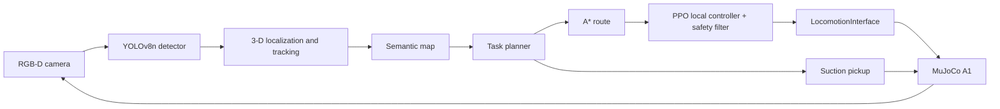
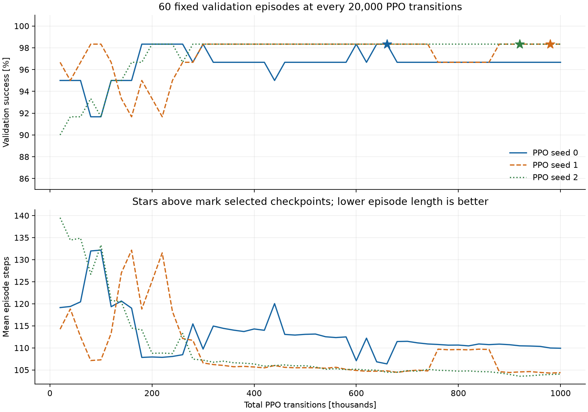
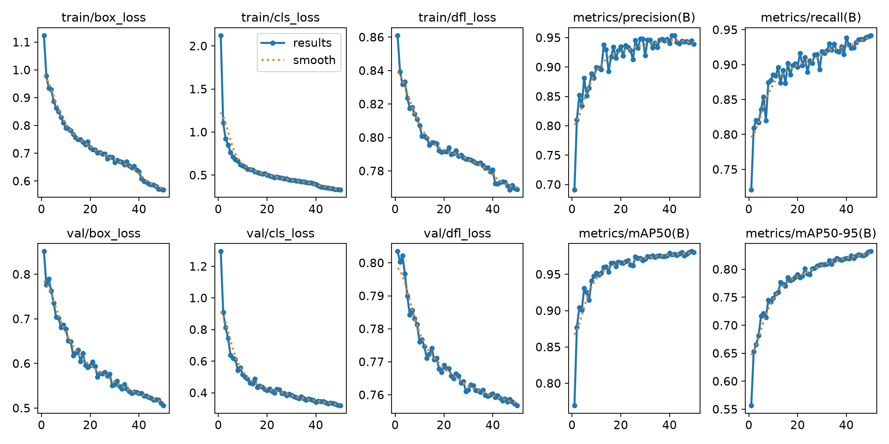
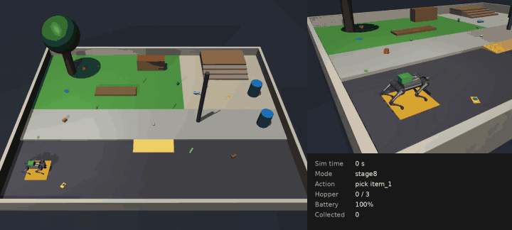
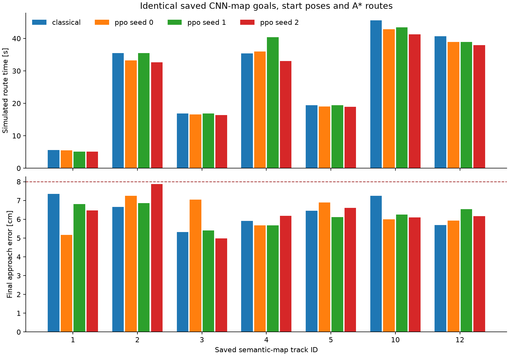
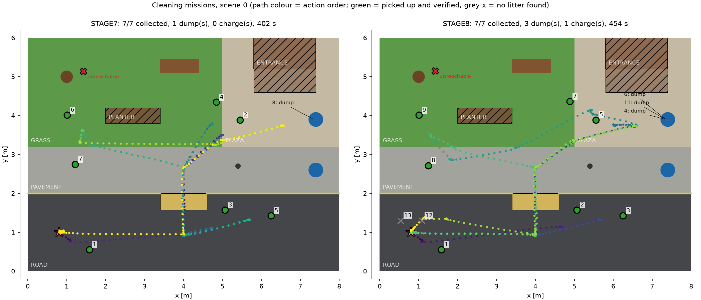

# CleanQuad — PPO Navigation for an Autonomous Litter-Collecting Quadruped

> **Course:** Robot Autonomy (2026) · **Group:** group-10

---

## 1. Project Overview

**One-line summary:** A simulated Unitree A1 finds litter on a small campus with its camera, maps it, walks to each item using A* and a PPO controller, collects it, empties its hopper into a bin and returns to base.

- **Robot:** Unitree A1 ([MuJoCo Menagerie](https://github.com/google-deepmind/mujoco_menagerie) model)
- **Simulator:** MuJoCo
- **RL Algorithm(s):** PPO (Stable-Baselines3) for local navigation. Locomotion is a model-based trot controller, not learned.
- **Task:** Campus litter collection: detect, localize, map, navigate, pick up, and plan around hopper and battery limits

### Problem Statement

Cleaning a campus needs more than a walking robot. The robot has to recognise litter among look-alike clutter (leaves, stones, sticks), work out where each item is in 3-D, stay on safe terrain across curbs and a ramp, and decide what to do next with a limited hopper and battery. Each stage's errors feed into the next, so the hard part is making the whole chain work in one continuous run rather than making any single component work alone.The idea first occurred to one of the authors, ArijitGuha0179, when he spotted litter in an inaccessible area from his hostel room one day.

### Approach

The project is built in eight stages, each using the results of the ones before it:

| Stage | Component | Method |
|:---:|---|---|
| 1 | Locomotion | Trot gait, 3-D leg IK and yaw stabilisation behind a `LocomotionInterface(vx, wz)` |
| 2 | Environment | Procedural 8 × 6 m campus with a 6 cm curb, an 8° ramp, obstacles, litter and distractors |
| 3 | Perception | YOLOv8n fine-tuned on auto-labelled renders, compared with a classical colour baseline |
| 4 | Localization | RGB-D back-projection with temporal track fusion |
| 5 | Semantic mapping | 10 cm grid of terrain, occupancy and traversability, plus litter records |
| 6 | Navigation | A* global route with a PPO local controller and a safety filter |
| 7 | Pickup | Simulated suction nozzle with camera-verified capture |
| 8 | Task planning | Exact dynamic program over pickup order and bin dumps, replanned after every action |



PPO is trained in a fast, randomized 2-D model of the known campus map and then deployed in MuJoCo. The results below therefore describe **A\* + PPO + guards**, not an end-to-end policy.

| Item | Description |
|---|---|
| Observation space | 25 normalized values: local target x/y and distance, sine/cosine of bearing and final-heading error, alignment/final flags, measured forward and yaw velocity, ramp/height features, 12 obstacle rays from the known map |
| Action space | 2 continuous values: forward speed 0 to 0.30 m/s, yaw rate ±0.30 rad/s |
| Reward | `12 × distance progress − 0.015` per step, `+ 0.5 × heading progress` near a final goal, `− 0.004 × bearing error − 0.001 × squared action change`; collision −25, success +20 |
| Episode termination | Collision or success; truncated at 450 steps. Final-approach success needs ≤ 8 cm position error, ≤ 6° heading error and speed < 0.02 m/s for 5 steps |
| Network | Separate actor and critic MLPs, each 64-64 with Tanh activation (Stable-Baselines3 default), initialized by imitation of a teacher controller |

Training used 1,001,472 PPO transitions per seed (3 seeds) on CPU, with learning rate 3e-5, 1,024 steps per environment across 2 environments, minibatch 256, 5 epochs, γ = 0.995, GAE λ = 0.95 and clip range 0.15.

---

## 2. Team Members

**Group Number:** group-XX

| Sl. No. | Roll No. | Name | GitHub Username | Contribution |
|:---:|---|---|---|---|
| 1 | 26AI60R04 | Arijit Guha | [@ArijitGuha0179](https://github.com/ArijitGuha0179) | Stage 1 locomotion, Stage 3 litter detection|
| 2 | 26AI60R06 | Pankaj Giri | [@p-zen07](https://github.com/p-zen07) | Stage 2 campus environment |

---

## 3. Weekly Progress

Each week covers one stage. Consecutive stages that were smaller or built directly on each other share a week. Dates are the commit dates in the repository history.

### Week 1 — Stage 1: Quadruped Locomotion (committed 5 Oct 2026)
- **Goals:** Make the A1 walk reliably and give later stages one simple velocity command interface.
- **Work done:** Built the trot gait generator, 3-D leg IK, yaw stabilisation, velocity calibration and `LocomotionInterface(vx, wz)`. The V2 gait passed 16/16 required and 4/4 optional tests with no falls, with speed errors under 2%.
- **Challenges:** The first gait reached only about 0.03 m/s and could not climb a 1 cm step, so a faster V2 profile was added. V2 still fails on steps of 4 cm or more, so curbs became no-go lines and level changes use an 8° ramp.
- **Next steps:** Build a campus that respects these terrain limits.

### Week 2 — Stages 2–3: Campus Environment and Litter Perception (committed 8 and 10 Oct 2026)
- **Goals:** Create the campus world and detect litter from the robot's own camera.
- **Work done:** Built a procedural campus with randomized litter and distractors; the robot completed a 9/9-waypoint route with no falls. Generated 4,000 auto-labelled images and trained YOLOv8n and a colour baseline. YOLOv8n reached 0.965 mAP@0.5 on the test set against 0.342 for the baseline.
- **Challenges:** Raising terrain contact priority slowed the gait, so the terrain keeps MuJoCo's default contact. Blue dustbins are sometimes detected as cans because bins were never labelled as negatives. The detector is trained on renders only, so these numbers do not transfer to a real camera.
- **Next steps:** Turn 2-D detections into world positions.

### Week 3 — Stages 4–5: 3-D Localization and Semantic Mapping (committed 10 and 11 Oct 2026)
- **Goals:** Produce a reliable list of litter positions and combine it with the terrain into a map.
- **Work done:** Built the depth back-projection and tracking pipeline: 8/8 items, no duplicates or false positives, 3.36 cm mean and 4.92 cm maximum error. Built an 80 × 60 semantic grid with reload support; all 12 acceptance checks passed.
- **Challenges:** An early route confirmed a duplicate bottle track. It was fixed with recent-position association, a three-frame class confirmation rule and better duplicate suppression. The no-depth flat-ground baseline failed (7/8 items, 12 false positives) because the terrain is not flat. The map was validated offline for one seed only.
- **Next steps:** Navigate to mapped items, starting with an A* baseline.

### Week 4 — Stage 6: Map Planning and Learned Navigation (committed 12 Oct 2026)
- **Goals:** Reach litter safely with a classical baseline and a learned controller, and compare them in MuJoCo.
- **Work done:** Built clearance-aware A* and the classical follower, then trained three PPO models for about 1 million transitions each. All 59/59 MuJoCo routes passed. A continuous live mission visited 7/7 reachable targets and returned to base.
- **Challenges:** One item behind the tree, planter and bench cannot be reached with the 0.45 m safety footprint, and the padding was not reduced to force coverage. Live rendering and detection were expensive on CPU, so the full mission ran the camera at 1 Hz. The live map also kept one unmatched detection.
- **Next steps:** Add physical pickup and decide the order of work.

### Week 5 — Stages 7–8: Pickup and Task Planning (committed 13 Oct 2026)
- **Goals:** Collect items, and plan around hopper capacity and battery.
- **Work done:** Added a suction nozzle and hopper with camera-verified pickup, which captured 52/52 trials on the first attempt. Added an exact dynamic-program task planner with battery checks and replanning. The planned live mission collected 7/7 reachable items with 3 bin dumps and 1 charging return.
- **Challenges:** The A1 has no arm and the litter has no physics, so suction is modelled as a capture zone. The nozzle was moved forward to reach an item 0.38 m from a curb. Live capture margin is thin: tip error reached 6.8 cm against a 7 cm radius. Battery handling is greedy, which caused one extra detour.
- **Final status:** All eight stages are complete in simulation, for the known static campus. Only scene 0 has a live CNN map, robot pose comes from the simulator, and nothing has been tested on hardware.

---

## 4. Results

### Training Curves

PPO validation success and episode length, with the selected checkpoints starred:



YOLOv8n training over 50 epochs:



### Simulation Videos

**Stage 8 cleaning mission:** the whole mission as a short time-lapse, at about 23× speed.

[](results/videos/stage8_cleaning_mission.mp4?raw=true)

**[Open the full video](results/videos/stage8_cleaning_mission.mp4?raw=true)** (7 min 34 s, 55 MB). It is too large to play on GitHub, so your browser may download it instead.

During charging, the on-screen battery value keeps counting down until it jumps to 100%. This is a display quirk: the logged minimum for the mission is 17.7%.

| Description | Video |
|---|---|
| Stage 8 cleaning mission, full video | [results/videos/stage8_cleaning_mission.mp4](results/videos/stage8_cleaning_mission.mp4?raw=true) |
| Live perception demo, YOLOv8n | [results/videos/perception_demo_cnn.gif](results/videos/perception_demo_cnn.gif) |
| Live perception demo, colour baseline | [results/videos/perception_demo_color.gif](results/videos/perception_demo_color.gif) |

To run the mission yourself in the live viewer, use `--viewer` (see [section 5.4](#54-evaluation--visualise-a-trained-policy)).

### Quantitative Results

**Navigation.** Episode return and average velocity are not reported for each controller, because the project evaluates controllers on route success and physical safety checks instead. No route recorded a fall or forbidden contact.

| Experiment | Algorithm | Routes passed | Max goal error (cm) | Max heading error (°) | Scene-0 total time, 7 goals (s) |
|---|---|---|---:|---:|---:|
| Baseline | A* + classical follower | 21/21 | 7.95 | 5.46 | 198.94 |
| Final | A* + PPO, seed 0 (deployed) | 22/22 | 7.41 | 5.65 | 192.10 |
| Final | A* + PPO, seed 1 | 8/8 | 6.85 | 5.48 | 199.56 |
| Final | A* + PPO, seed 2 | 8/8 | 7.87 | 5.80 | 185.34 |

Each PPO model also succeeded on 100/100 fresh test cases in the 2-D training environment, and on 59/60 validation cases at its selected checkpoint.



**Perception** (test set of 500 images from unseen layouts):

| Metric | Colour baseline | YOLOv8n |
|---|---:|---:|
| mAP@0.5 | 0.342 | **0.965** |
| mAP@0.5:0.95 | 0.181 | **0.818** |
| Precision | 0.671 | **0.948** |
| Recall | 0.420 | **0.939** |
| F1 | 0.516 | **0.944** |

**Localization** (seed 0, 9-waypoint route):

| Metric | Flat-ground baseline | Depth pipeline |
|---|---:|---:|
| Items mapped | 7/8 | **8/8** |
| False positives | 12 | **0** |
| Mean final error (cm) | 10.11 | **3.36** |
| Maximum final error (cm) | 19.70 | **4.92** |

**Pickup and full missions:**

| Experiment | Result |
|---|---|
| Headless pickup trials (3 scenes, perturbed starts) | 52/52 captured on the first attempt; nozzle error mean 3.6 cm, max 6.7 cm |
| Stage 7 live mission (fixed order) | 7/7 reachable items, 1 bin dump, 402 simulated seconds, 6/6 checks pass |
| Stage 8 live mission (planned) | 7/7 reachable items, 3 bin dumps, 1 charging return, 2 false detections rejected, lowest battery 17.7%, 454 simulated seconds, 8/8 checks pass |



### Discussion

**What worked.** Keeping a classical baseline at each stage showed where learning actually helped. YOLOv8n clearly beat the colour detector. PPO did not clearly beat the classical follower: it was faster with two seeds and slightly slower with the third, on seven fixed goals, so this is not evidence of a general performance gain. Verifying pickup with the camera, and letting the simulator decide what was captured, means a wrong position produces a real miss rather than a false success.

**What didn't.** The conservative footprint leaves one of the eight scene-0 items unreachable, so all-item coverage is 87.5% even though every reachable route succeeds. The battery rule sits outside the planner's optimization, and it sent the robot home to charge with a full hopper. A dustbin can still be mistaken for a can, and the capture margin in live missions is thin.

**With more time.** We would add a "not litter" class for bins, plan battery jointly with pickup order, try orientation-aware footprint planning for the narrow passage, and validate on more scenes. Noisy pose estimates, dynamic obstacles, real suction physics and real hardware are all still untested.

---

## 5. How to Reproduce

### 5.1 Requirements
- OS: Linux. Results were produced on WSL Kali Linux; `--viewer` runs need a display.
- Python: 3.14 (tests and the Stage 8 mission were verified on 3.14.6)
- GPU: Optional. Only YOLOv8n training benefits (GTX 1650, about 74 min). PPO training and live missions ran on CPU.

### 5.2 Installation
```bash
git clone --recurse-submodules https://github.com/2026-Robot-Autonomy/Clean_Quad.git
cd Clean_Quad

python -m venv venv
source venv/bin/activate
pip install -r requirements.txt
```

The robot model comes from the `assets/mujoco_menagerie` submodule. If you cloned without `--recurse-submodules`, run `git submodule update --init`.

### 5.3 Training
```bash
# PPO navigator: the setup used for the three final models (about 13-23 min per seed on CPU)
python -B experiments/29_train_navigation.py --seeds 0 1 2 --timesteps 1000000 \
    --output models/navigation/ppo_full --initial-policy models/navigation/ppo/seed_0/imitation.zip

# Litter detectors: generate the dataset first (not stored in the repository)
python -B experiments/22_generate_dataset.py
python -B experiments/23_train_detectors.py              # add --device cpu if you have no GPU
```

These commands overwrite the supplied models. To keep them, pass a different `--output` to the PPO training. Omitting `--initial-policy` also trains a new imitation initializer.

### 5.4 Evaluation / Visualise a Trained Policy
```bash
# Regression tests
python -B -m unittest discover -s tests

# Full cleaning mission with planning; omit --viewer to run headless
python -B experiments/34_cleaning_mission.py --mode stage8 --require-pass --viewer

# Pickup trials (about 2 min)
python -B experiments/33_pickup_trials.py --require-pass

# Live navigation mission with the deployed PPO checkpoint
python -B experiments/31_live_navigation.py --checkpoint models/navigation/ppo_full/seed_0/best.zip \
    --camera-rate 1 --output results/logs/navigation/live/my_run --require-pass --viewer

# PPO against the classical baseline in MuJoCo
python -B experiments/30_evaluate_navigation.py --models models/navigation/ppo_full \
    --output results/logs/navigation/comparison_full/my_run --policy-seeds 0 --scene-seeds 0 1 2 --require-pass
```

Experiments are numbered in build order. Each stage's report in [`docs/`](docs/) lists its full set of commands.

### 5.5 Pretrained Models

All trained models are in this repository, so training is not needed to run the missions:

| Model | Path |
|---|---|
| PPO navigator (deployed) | [`models/navigation/ppo_full/seed_0/best.zip`](models/navigation/ppo_full/seed_0/best.zip) |
| PPO seeds 1 and 2 | `models/navigation/ppo_full/seed_{1,2}/` |
| YOLOv8n litter detector | [`models/litter_yolov8n.pt`](models/litter_yolov8n.pt) |
| Colour baseline | [`models/color_baseline.npz`](models/color_baseline.npz) |

---

## 6. Repository Structure

```
.
├── README.md               # This file: overview, team, weekly log, results
├── requirements.txt        # Python dependencies
├── assets/
│   └── mujoco_menagerie/   # Unitree A1 model (git submodule)
├── src/
│   ├── controllers/        # Gait, leg IK, LocomotionInterface (Stage 1)
│   ├── environment/        # Procedural campus, litter, distractors (Stage 2)
│   ├── perception/         # Camera, dataset, YOLO and colour detectors (Stage 3)
│   ├── localization/       # Depth localization and tracking (Stage 4)
│   ├── mapping/            # Semantic grid and serialization (Stage 5)
│   ├── navigation/         # A*, followers, RL environment, PPO navigator (Stage 6)
│   ├── manipulation/       # Suction tools, posture, pickup skill (Stage 7)
│   ├── tasks/              # Task planner (Stage 8)
│   ├── simulation/         # Robot setup and viewer helpers
│   └── utils/              # Orientation and inspection helpers
├── experiments/            # Numbered entry-point scripts, 01 to 35, in build order
├── tests/                  # Regression tests
├── models/                 # Trained detectors and PPO checkpoints
├── results/
│   ├── figures/            # Figures used in the reports
│   ├── logs/               # Metrics, routes and maps; some are inputs to tests and later stages
│   └── videos/             # Perception demo animations
└── docs/                   # Detailed report for each stage
```

The dataset (`data/`), YOLO run output (`models/runs/`), base weights (`yolov8n.pt`) and raw Stage 1 traces are not stored in the repository. All of them are rebuilt by the experiments or downloaded automatically.

**Reports:** [Stages 1–5](docs/CLEANQUAD_COMPLETE_REPORT_STAGES_1-5.md) · [Stage 6](docs/STAGE_6_FINAL_REPORT.md) · [Stages 7–8](docs/STAGE_7_8_REPORT.md)

---

## 7. References & Resources

### Research Papers
1. J. Schulman, F. Wolski, P. Dhariwal, A. Radford and O. Klimov, "Proximal Policy Optimization Algorithms," arXiv:1707.06347, 2017. [[link]](https://arxiv.org/abs/1707.06347)
2. J. Schulman, P. Moritz, S. Levine, M. Jordan and P. Abbeel, "High-Dimensional Continuous Control Using Generalized Advantage Estimation," arXiv:1506.02438, 2015. [[link]](https://arxiv.org/abs/1506.02438)
3. E. Todorov, T. Erez and Y. Tassa, "MuJoCo: A physics engine for model-based control," IROS, 2012.
4. P. E. Hart, N. J. Nilsson and B. Raphael, "A Formal Basis for the Heuristic Determination of Minimum Cost Paths," IEEE Transactions on Systems Science and Cybernetics, 1968.

### Code Repositories
1. [MuJoCo Menagerie](https://github.com/google-deepmind/mujoco_menagerie) — Unitree A1 robot model
2. [Stable-Baselines3](https://github.com/DLR-RM/stable-baselines3) — PPO implementation
3. [Ultralytics](https://github.com/ultralytics/ultralytics) — YOLOv8n and COCO-pretrained weights
4. [Gymnasium](https://github.com/Farama-Foundation/Gymnasium) — RL environment interface

### Videos / Tutorials
None used.

### Other (blogs, docs, datasets, robot models)
1. [Stable-Baselines3 PPO documentation](https://stable-baselines3.readthedocs.io/en/master/modules/ppo.html) — PPO settings and CPU guidance
2. [MuJoCo documentation](https://mujoco.readthedocs.io/) — simulator and `MjSpec` world building
3. Litter dataset — generated by this project in simulation (`experiments/22_generate_dataset.py`)

---

## 8. License & Acknowledgements
This project was done as part of the Robot Autonomy course (2026). The campus layout is not inspired by IIT Kharagpur but the Idea is to implement it in that scale.
