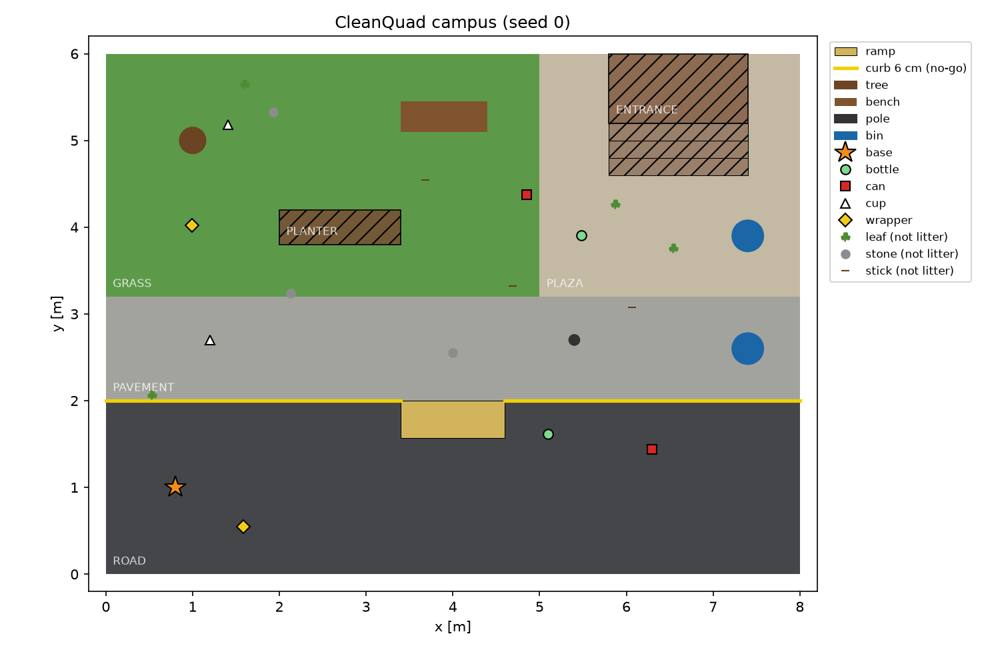
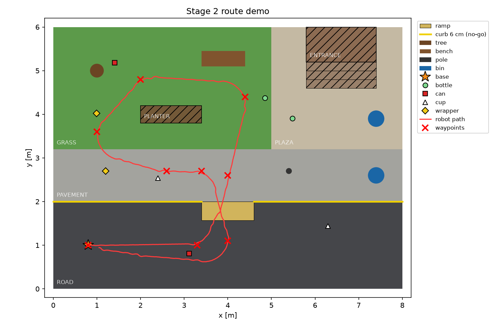
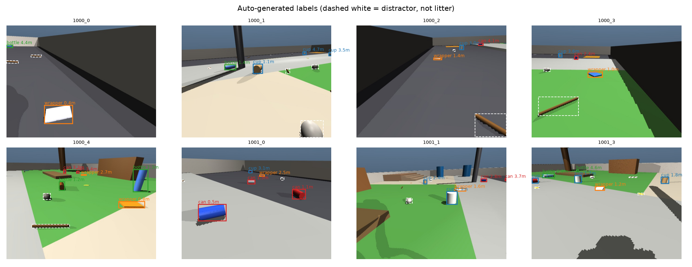
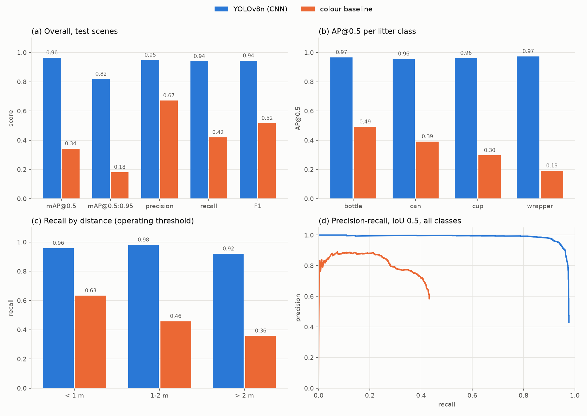
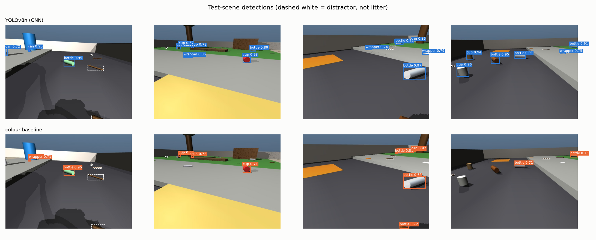
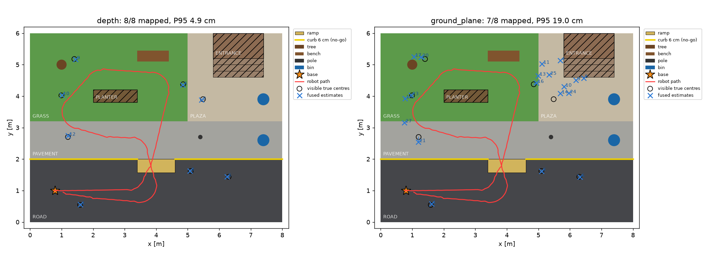
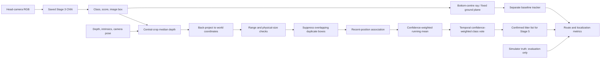

# CleanQuad — Complete Report Through Stage 5

This report brings together all four project reports in docs. It covers the completed
locomotion, campus environment, perception, localization, and offline semantic-mapping
work, including the detailed methods, evidence, reproducible commands, design contracts,
failure investigations, and remaining validation. Stage 6 navigation is the next milestone.

## Contents

- [Project status](#project-status)
- [Stage 1: quadruped locomotion](#stage-1)
- [Stage 2: campus environment](#stage-2)
- [Stage 3: litter perception](#stage-3)
- [Stage 4: localization results](#stage-4)
- [Stage 4: complete technical reference](#stage4-technical-reference)
- [Stage 5: semantic-mapping results](#stage-5)
- [Stage 5: implementation, API, artifacts, and tests](#stage5-implementation)
- [Stage 5: design contract and acceptance criteria](#stage5-design)
- [Reproduction commands](#reproduction)
- [Next steps: Stages 6–8](#next-steps)
- [Source coverage](#source-coverage)

<a id="project-status"></a>

## Project status

*Simulated Unitree A1 quadruped for campus litter collection (MuJoCo). Status as of 11 Oct 2026.*

| Stage | Title | Status |
|---|---|---|
| 1 | Quadruped locomotion | **Done** (V1 certified; V2 fast gait added and certified) |
| 2 | Campus / street environment | **Done** |
| 3 | Litter perception | **Done** (CNN + classical baseline, evaluated) |
| 4 | 3-D litter localization | **Done** (CNN seed-0 headless route passes; 31 unit tests pass) |
| 5 | Semantic mapping | **Done** (offline seed-0 map; 12 acceptance checks and 54 total unit tests pass) |
| 6 | Autonomous navigation (RL navigator) | **Next** (planned: A* baseline, then PPO navigator) |
| 7 | Cleaning / pickup | Planned |
| 8 | Task planning & optimization | Planned |

---

<a id="stage-1"></a>

## 1. Stage 1 — Quadruped Locomotion

### 1.1 Approach
A model-based (non-learned) trot controller drives the 12 position actuators of the Unitree A1
(MuJoCo Menagerie model):

- **Trot gait generator.** Diagonal leg pairs swing alternately; each foot follows a swing/stance trajectory.
- **3-D leg inverse kinematics.** Converts each foot target into hip/thigh/calf angles.
- **Yaw stabilisation.** A proportional heading term keeps straight walking straight.
- **Velocity → stride calibration.** Measured tables map commanded `vx` to stride length, and `wz` to a left/right stride difference.
- **`LocomotionInterface(vx, wz)`.** The single entry point used by every later stage. Commands are clamped to the certified envelope, and the heading reference is re-anchored to the actual yaw whenever the command changes.

Two gait profiles are kept in `src/controllers/gait_profiles.py`:

| Profile | Step freq. | Foot lift | Speed envelope | Use |
|---|---|---|---|---|
| `V1_SLOW` (original) | 1 Hz | 3 cm | ≈ 0.03 m/s | Original certification (experiment 15); kept bit-identical |
| `V2_FAST` (default) | 4 Hz | 7 cm | vx −0.3 … 0.5 m/s, \|wz\| ≤ 0.5 rad/s | All Stage 2–3 work |

V2 was added because V1 was too slow for a campus task and could not climb even a 1 cm step.
Experiment 16 confirms that V1 still reproduces its original certification exactly.

### 1.2 V2 certification (experiment 21)
**Result: 16/16 required tests and 4/4 optional tests pass, with no falls.**

| Test | Target | Measured | Error |
|---|---|---|---|
| Forward | 0.10 / 0.30 / 0.50 m/s | 0.101 / 0.300 / 0.491 m/s | 0.7 / 0.2 / 1.8 % |
| Backward | −0.10 / −0.30 m/s | −0.099 / −0.299 m/s | 0.6 / 0.2 % |
| Curve | vx 0.3, wz ±0.5 rad/s | wz ±0.503 rad/s | 0.6 % |
| Rotate in place | wz ±0.3 rad/s | ±0.303 rad/s | ≤ 1.3 % |

- Maximum roll is 5.2° and maximum pitch is 3.4° across all tests.
- Stopping from 0.5 m/s coasts about 2 cm.

### 1.3 Terrain capability (experiment 18, V2 at 0.3 m/s)

| Feature | Pass | Unstable | Fail |
|---|---|---|---|
| Ramp up / down | 3°–15° all pass | — | — |
| Step **up** | 1 cm | 2–3 cm | ≥ 4 cm (falls or blocked) |
| Step **down** | 1–3 cm | 4–8 cm | — |
| Friction change (road → grass, μ 0.6) | pass | — | — |

**Design consequence:** curbs are treated as **no-go lines**, and level changes are reached through
an 8° ramp (a curb cut).

---

<a id="stage-2"></a>

## 2. Stage 2 — Campus Environment



### 2.1 World
The campus is an 8 × 6 m area inspired by IIT-KGP, built procedurally with `MjSpec` in `src/environment/`.

- **Ground surfaces:**
  - Road at z = 0.
  - Pavement, grass and plaza raised **6 cm** behind a curb.
  - An **8° ramp** (curb cut) at x 3.4–4.6 m connecting the two levels.
- **No-go areas:** planter, stairs, building entrance.
- **Obstacles:** tree, bench, lamp pole, 2 dustbins.
- **Litter:** 4 classes (bottle, can, cup, wrapper), with randomised colour and size, lying or standing.
  Items are mocap bodies, so they can be "collected" (removed) in Stage 7.
- **Distractors:** leaves, stones and sticks. They are litter-like clutter that must *not* be detected.
- **Per-seed randomisation:** litter and distractor placement, plus lighting.
- **Map API:** `zone_at`, `ground_height_at` and `is_traversable` in `layout.py`, ready for Stage 5/6.

### 2.2 Integration test (experiment 19)
A scripted route of 9 waypoints goes road → ramp → pavement → grass around the planter → back down the ramp → home.



**Result: 9/9 waypoints in 63.4 s, no falls and no curb contacts.** The route was driven by a simple
heading follower with no planning; real navigation is Stage 6.

**Note on terrain contact:** each A1 leg touches the ground with both the foot and the calf
capsule. Giving the terrain a higher contact priority slowed the gait, so the terrain uses MuJoCo's
default contact with μ = 1.0 (and μ = 0.6 on grass).

---

<a id="stage-3"></a>

## 3. Stage 3 — Litter Perception

### 3.1 Sensor
An RGB-D head camera is mounted on the trunk at (0.16, 0, 0.03) m and tilted 25° down.

- Image: 640 × 480, vertical field of view 70°.
- Outputs per frame: RGB, depth and a segmentation image.
- The camera's position and intrinsics are recorded with every frame, for Stage 4.

### 3.2 Dataset (experiment 22)
Labels are generated **automatically** from the simulator's segmentation render, so no manual
annotation is needed. An object counts as labelled if at least 40 visible pixels of it are in view.
Labels are in YOLO format.

| Split | Scenes (seeds) | Images | Purpose |
|---|---|---|---|
| train | 600 (1000–1599) | 3000 | Training |
| val | 100 (2000–2099) | 500 | Threshold tuning, early checks |
| test | 100 (3000–3099) | 500 | Final numbers only |

- Each scene is rendered from 5 robot viewpoints.
- Splits use disjoint seeds, so the test set contains completely unseen layouts.



### 3.3 Detectors (experiment 23)

| | **Main: YOLOv8n CNN** | **Baseline: classical colour** |
|---|---|---|
| Method | COCO-pretrained YOLOv8n, fine-tuned | HSV colour-histogram Bayes classifier, then connected blobs, then a per-blob class vote |
| Training | 50 epochs, 640 px, batch 16, about 74 min on a GTX 1650 (4 GB) | A few seconds (histograms from training masks) |
| Model | `models/litter_yolov8n.pt` | `models/color_baseline.npz` |

### 3.4 Results on the test set (experiment 24)
For each detector, the operating threshold is the confidence that maximises F1 on the **validation** split.
Boxes count as matched at IoU ≥ 0.5.

| Metric | **YOLOv8n (CNN)** | Colour baseline |
|---|---|---|
| mAP@0.5 | **0.965** | 0.342 |
| mAP@0.5:0.95 | **0.818** | 0.181 |
| Precision | **0.948** | 0.671 |
| Recall | **0.939** | 0.420 |
| F1 | **0.944** | 0.516 |
| False positives / image | **0.22** | 0.86 |
| False positives on distractors / image | **0.00** | 0.02 |
| Latency (per image) | **8 ms** (148 img/s, GPU) | 133 ms (7.6 img/s, CPU) |

AP@0.5 per class:

| Class | CNN | Baseline |
|---|---|---|
| bottle | 0.967 | 0.491 |
| can | 0.956 | 0.391 |
| cup | 0.962 | 0.296 |
| wrapper | 0.974 | 0.191 |

Recall by distance:

| Distance | CNN | Baseline |
|---|---|---|
| < 1 m | 0.958 | 0.633 |
| 1–2 m | 0.980 | 0.458 |
| > 2 m | 0.919 | 0.358 |




**Interpretation:**
- **The colour baseline works only when colour is unique.** Colour alone cannot separate litter
  from same-coloured scenery or other litter classes. It is weakest on wrappers and cups, whose
  colours vary most, and it degrades quickly with distance as objects shrink to a few pixels.
- **The CNN uses shape and context.** It stays above 0.9 recall even beyond 2 m and ignores the
  distractors completely.
- **This justifies using ML here.** The classical method is clearly insufficient, which satisfies
  the brief's rule "classical baseline first, ML only where it measurably helps".

### 3.5 Closed-loop demo (experiment 25)
The robot walks the Stage 2 route while running the detector on its head camera at 5 Hz.
Each frame is scored against ground truth from segmentation.

| | CNN | Colour baseline |
|---|---|---|
| Litter items detected (of 8 in view) | **8 / 8** | 6 / 8 |
| Frame-level precision / recall | **0.976 / 0.976** | 0.792 / 0.679 |
| Detector rate | 71.6 frames/s | ≈ 7 frames/s |

Animations: `results/videos/perception_demo_cnn.gif` and `results/videos/perception_demo_color.gif`.

### 3.6 Known limitations
1. **Blue dustbins are sometimes detected as "can".** Bins were never labelled as negatives. Fix:
   add a `bin` / "not litter" class, or more bin views, to the dataset.
2. **Simulation-to-real gap.** The model is trained and tested only on rendered images, so these
   numbers do not transfer to a real camera.
3. **The detector outputs 2-D boxes.** Stage 4 now supplies world positions through depth
   back-projection and temporal fusion; uncertain robot pose and real-camera transfer remain unverified.

---

<a id="stage-4"></a>

## 4. Stage 4 — 3-D Litter Localization

**Status: complete for the verified CNN seed-0 headless route.** The original milestone was
one completed route producing a class-labelled world-position list for every visible item,
with final position error below about 10 cm. The saved result meets that milestone.

### 4.1 Implemented pipeline

Experiment 26 combines the saved Stage 3 CNN, synchronized RGB-D frames and camera pose,
central-crop median depth, world-coordinate back-projection, and persistent track fusion.
Recent observations help associate changing visible surface points with their established
identity. Confidence-weighted class votes and repeated class support determine the confirmed
litter list. The same route evaluates a separate no-depth, flat-ground estimate.

Runtime localization uses no simulator litter identities or true positions. Those remain in
the evaluator. Camera pose is supplied by the simulator, and litter is assumed stationary.
Implementation is in `src/localization/`; the runner is
[experiments/26_localization_pipeline.py](../experiments/26_localization_pipeline.py).

### 4.2 Localization methods and why their results differ

Both methods receive the same CNN detections, camera intrinsics and pose, and sampled
route frames. Each method has its own tracker using the same association, fusion, and
confirmation rules. Simulator truth is used only to evaluate their estimates.

**Depth-based localization (`depth`) — the method used for the Stage 4 litter list.**
Take the median valid depth from the central 60% of each detection box, back-project the
box centre into camera coordinates, and transform that point into world coordinates using
the camera pose. The measured depth supplies the object's distance without assuming a
ground height. The central crop and median reduce background contamination; temporal
position fusion and class voting produce the confirmed item records.

**Flat-ground ray-intersection baseline (`ground_plane`) — the no-depth comparison.**
Take the bottom-centre pixel of the detection box and construct a ray from the camera
through that pixel. Estimate position where the ray intersects a fixed horizontal plane,
`z = 0`. This method uses neither the depth image nor the terrain-height map. It tests how
well localization can work using camera geometry and a simple flat-ground assumption.

**Why depth succeeds on the verified route.** Measured depth locates the visible object
surface in 3-D on the road, raised pavement, grass, plaza, and ramp without forcing all
positions onto one plane. Fusion reduces observation variation, and the corrected
association/confirmation rules preserve one identity per item. The final seed-0 depth
map contains **8/8 items**, with **zero duplicates, misses, or false positives**, mean error
**3.36 cm**, and maximum error **4.92 cm**. It meets the 10 cm final-position requirement.
This is the verified simulation result, not a claim of real-camera performance.

**Why the flat-ground baseline fails.** Pavement, grass, and plaza are raised 6 cm, and
the ramp changes height along its length. Litter centres are also above their support
surface. Intersecting every viewing ray with `z = 0` therefore introduces vertical and
horizontal position bias. For elevated objects, that ray generally reaches the assumed
plane beyond the actual support surface; shallow viewing angles can amplify the error.
The resulting estimates can vary as the robot moves, making association less reliable.
Repeated averaging cannot remove the incorrect ground-plane assumption.

The baseline maps only **7/8 items** and produces **19 confirmed tracks**, of which
**12 are unmatched final estimates** counted as false positives by the evaluator. Its
matched-map mean error is **10.11 cm** and maximum error **19.70 cm**. It fails the
completion criterion because one item is missed, unmatched tracks remain, and matched
positions exceed 10 cm. These counts are measured; attributing every unmatched track
to a specific cause would require further analysis of individual tracks.

**Impact on robot performance.** The flat-ground estimate is an independent evaluation
baseline, not the localization input intended for Stage 5. Its failure does not invalidate
the passing depth map or the observed walking stability: both methods were evaluated
during the same **9/9-waypoint route without a fall**. The current scripted locomotion
controller does not use either litter map for steering. Stage 5 should consume the verified
depth `tracks.json`; navigation and pickup using flat-ground positions have not been validated.

### 4.3 Verified CNN seed-0 result

| Metric | Depth pipeline | Flat-ground baseline |
|---|---|---|
| Visible items mapped | **8/8** | 7/8 |
| Confirmed tracks | **8** | 19 |
| Mean / P95 final error | **3.36 / 4.89 cm** | 10.11 / 19.04 cm |
| Maximum final error | **4.92 cm** | 19.70 cm |
| Duplicates / missed items / false positives | **0 / 0 / 0** | 0 / 1 / 12 |
| Route | **9/9 waypoints, no fall** | Same route |
| Completion criterion | **Passed** | Failed |

The route processed 318 frames at 5 Hz over 63.412 simulated seconds. The command with
`--require-pass` returned exit code 0. All **31 Stage 4 unit tests passed** in the Stage 4 verification suite.
The 10 cm completion gate applies to the fused final positions; individual observations
have mean error 3.86 cm and P95 error 6.53 cm and can exceed 10 cm.

Evidence: [summary CSV](../results/logs/localization/cnn/summary.csv),
[depth metrics](../results/logs/localization/cnn/seed_0/depth/metrics.json),
[flat-ground metrics](../results/logs/localization/cnn/seed_0/ground_plane/metrics.json),
[confirmed litter list](../results/logs/localization/cnn/seed_0/depth/tracks.json),
[map matches](../results/logs/localization/cnn/seed_0/depth/map_matches.csv), and
[run metadata](../results/logs/localization/cnn/seed_0/run.json). The metadata records the
model checksum, dependency versions, and `viewer_enabled: false`.



### 4.4 Duplicate-tracking challenge and mitigation

An earlier full CNN route matched all eight items but confirmed nine tracks. At about
18 seconds, an extra wrapper detection started a tentative track beside an established
bottle. The old nearest-mean association assigned two later bottle observations to the
new track because its fresh position was closer to the currently visible surface. Three
mixed-label observations then confirmed it as another bottle, yielding one duplicate and
a failed completion check despite adequate final position accuracy.

The fix added recent-position evidence to association, required three frames supporting
the winning class before confirmation, and extended duplicate-box suppression to small
contained fragments with matching 3-D positions. One observation per track per frame and
the spatial gates remain enforced. Tests preserve separate nearby objects and objects at
different depths. The corrected saved log assigns the later bottle observations to the
original track; the extra wrapper remains tentative and expires.

Seven new regressions brought the suite from 24 to 31 tests. Four exposed failures in
the old implementation, and all passed after the changes. The observed failure sequence,
mitigation details, test names, and evidence are in the
[Stage 4 localization guide](#stage4-details-duplicate-track-failure-and-mitigation).
The earlier failed outputs were overwritten by the successful rerun; the current saved
files report the corrected result.

### 4.5 Validation limits

The full headless seed-0 route is verified. The live viewer received a short startup check
only: `--viewer --max-time 0.6`, four frames, 0.6 simulated seconds, and 0/9 waypoints.
That check opened the window and exercised the litter markers but did not validate a full
viewer route. A subsequent full viewer run is now saved separately: its
[metadata](../results/logs/localization_viewer/cnn/seed_0/run.json) records
`viewer_enabled: true`, 318 frames, 9/9 waypoints, no fall, and about 408 seconds wall time.
Its [depth metrics](../results/logs/localization_viewer/cnn/seed_0/depth/metrics.json) also
report 8/8 items, eight tracks, zero duplicates/misses/false positives, maximum error
4.92 cm, and `stage4_passed: true`. These saved records verify the full viewer route
independently of the earlier short check.

Additional seeds and real-camera transfer remain unverified. The flat-ground baseline's
recorded failure is an ablation result, not a failure of the depth completion gate.
Stage 5's offline semantic map is now implemented and verified; full live map
integration remains unverified. See the [Stage 5 report](#stage5-implementation).

---

<a id="stage4-technical-reference"></a>

### 4.6 Complete localization technical reference

The following details complement the stage results above. The 31-test result belongs
to the Stage 4 verification run; the later combined Stage 4–5 suite passed 54 tests.

**Status: complete for the verified CNN seed-0 headless route, as of 10 October
2026.** The existing completion criterion is satisfied. A subsequent saved
full viewer route on seed 0 also passes. Additional seeds remain unverified.

The localization milestone in the
[overall progress report](#project-status) is a list of visible
litter items with class and world position after a campus route, with position
error below about 10 cm.
Stage 4 connects the existing detector and RGB-D camera to a persistent litter
tracker and a separate simulator evaluator.

<a id="stage4-details-pipeline"></a>

#### Pipeline



1. Walk the existing nine-waypoint campus route with `LocomotionInterface`.
2. Capture synchronized RGB, depth, camera pose, and intrinsics at 5 Hz.
   The runner refreshes MuJoCo kinematics after each sampled physics step.
3. Apply the detector operating threshold from Stage 3's validation results
   (`0.38` for the CNN).
4. Estimate world points using depth, and independently using a flat-ground
   ray intersection as the no-depth baseline.
5. Suppress weaker duplicate detections when estimated positions agree within
   8 cm and either image IoU is at least 0.5 or at least 85% of the smaller box
   overlaps the larger box. This also catches small fragment detections whose IoU
   is low. Separate image boxes and boxes at different depths remain separate.
   Associate same-class observations within 20 cm; allow a changed class within
   the stricter 8 cm gate. The association distance uses the closer of the fused
   mean and the last surface observation when that observation is at most one
   second old. The fused mean must still lie within the 20 cm association gate.
   This prevents a fresh false track from taking observations just because the
   established track's long-term mean differs from the current visible surface.
   Confirmed tracks win distance ties. Assign at most one observation per track
   per frame. Fuse positions using detection confidence as the weight, and choose
   the class with the largest accumulated confidence.
6. Confirm tracks after three separate frames supporting the winning class;
   three observations with mixed labels alone are insufficient. Tentative tracks
   expire after three seconds without another observation. Once confirmed,
   stationary tracks persist for the route, including during class changes.
   Reset the pipeline for a new episode.
7. Export the litter list, score it against simulator truth, and save figures.

Runtime localization and fusion never use segmentation masks, object identities,
object positions, or the campus terrain map. Segmentation determines which
objects were visible and supplies 2-D evaluation labels in the experiment.
Camera pose comes from the simulator; estimating robot pose is outside Stage 4.

<a id="stage4-details-geometry-and-assumptions"></a>

#### Geometry and assumptions

Depth is axial distance along the camera's viewing direction, in metres.
For pixel `(u, v)` with depth `d`, the MuJoCo camera-frame point is:

```text
p_camera = [(u - cx) * d / fx, -(v - cy) * d / fy, -d]
p_world  = cam_mat @ p_camera + cam_pos
```

The depth estimator samples the central 60% of the box in each dimension,
removes nonfinite and out-of-range depths, and takes the median. At least nine
valid samples are required. It projects the box centre using that median depth.
The point represents the visible object surface; error against the true object
centre therefore includes surface bias.

The baseline intersects the bottom-centre camera ray with `z = 0`. It reads
neither depth nor terrain height. Raised pavement and grass are consequently
expected to expose its flat-ground assumption.

Both estimators reject estimated camera ranges outside 5 cm–8 m and projected
physical extents above 35 cm. The extent check targets scenery such as the
known bin-as-can detections, without reading simulator labels. These parameters
are configurable in the experiment. Close items of the same class, persistent
detector mistakes, poor boxes, and contaminated depth can still create mapping
errors; the evaluator reports them rather than silently discarding them.

<a id="stage4-details-run-and-inspect"></a>

#### Run and inspect

Run from the repository root using a working Python environment containing
`requirements.txt` dependencies. A working MuJoCo OpenGL context is required;
the default route runs without an interactive viewer.

```bash
# Geometry, fusion, and metric regression tests
python -m unittest discover -s tests -v

# Full perception-to-localization route; exit nonzero when the target fails
python experiments/26_localization_pipeline.py --detector cnn --seeds 0 --require-pass

# Repeat on different layouts using identical parameters
python experiments/26_localization_pipeline.py --detector cnn --device cpu --seeds 0 1 2 --require-pass

# Optional route animation
python experiments/26_localization_pipeline.py --detector cnn --seeds 0 --save-video

# Live campus viewer with confirmed litter markers
python experiments/26_localization_pipeline.py --detector cnn --device cpu --seeds 0 --viewer --require-pass

# Isolate geometry using simulator 2-D boxes (diagnostic, not CNN validation)
python experiments/26_localization_pipeline.py --detector oracle --seeds 0 --require-pass

# Existing classical colour detector can use the same pipeline
python experiments/26_localization_pipeline.py --detector color --seeds 0
```

`--methods depth ground_plane` is the default. Other useful options are
`--threshold`, `--association-radius`, `--class-switch-radius`, `--min-observations`, `--depth-crop`,
`--max-extent`, `--ground-z`, `--rate`, `--max-time`, `--output`, and
`--no-figures`. `--require-pass` checks the depth pipeline and requires the
depth method to be selected. An oracle run only validates localization and
tracking with perfect 2-D boxes; it does not certify CNN performance.

Outputs are under `results/logs/localization/<detector>/`:

| File | Contents |
| --- | --- |
| `summary.csv` | One row per seed and estimator; route status, errors, duplicates, misses, and pass status |
| `seed_N/run.json` | Run settings, dependency versions, model checksum, and diagnostic-mode flag |
| `seed_N/depth/tracks.json` | Confirmed class-labelled positions, class votes, confidence, observation count, timestamps, and position spread |
| `seed_N/depth/metrics.json` | Overall and distance-bin errors, map counts, rejections, and route completion |
| `seed_N/depth/observations.csv` | Accepted observations and evaluation errors; unmatched detections have no true-position error |
| `seed_N/depth/map_matches.csv` | One-to-one final-map matches with their position errors |
| `seed_N/ground_plane/…` | Identical outputs for the baseline |
| `seed_N/route.csv` | Sampled robot trajectory |
| `seed_N/map.png`, `errors.png` | Fused map comparison and observation-error plots |
| `seed_N/localization.gif` | Optional camera animation |

<a id="stage4-details-metrics-and-completion-gate"></a>

#### Metrics and completion gate

All position errors are Euclidean 3-D distances to the simulator object centre,
reported in centimetres. XY error is also logged. Observation errors are scored
only for same-class detections matching a visible ground-truth box at IoU ≥ 0.5.
They are reported overall and for true camera-to-object distances `<1 m`,
`1–2 m`, and `≥2 m`.

Final-map evaluation uses maximum-cardinality, same-class, one-to-one matching
inside a 25 cm 3-D gate. An unmatched track with a candidate true object is a
duplicate; a track with no candidate is a false positive. Missed items are
visible true objects without a final match. Duplicate rate divides by confirmed
tracks, and missed-item rate divides by visible true objects. A bad estimate
beyond the gate counts as a false positive and a miss, so matched-only error
statistics cannot hide it from the completion check.

The depth run passes only if the robot completes all nine waypoints without a
fall, at least one litter item was visible, every visible item is matched,
there are no duplicates or false positives, and **every matched position is
within 10 cm**. Empty maps and incomplete routes cannot pass. The flat-ground
baseline is evaluated using the same criteria but its failure does not prevent
the depth experiment from succeeding.

<a id="stage4-details-duplicate-track-failure-and-mitigation"></a>

#### Duplicate-track failure and mitigation

An earlier full CNN seed-0 run reached all nine waypoints without falling and
matched all eight visible items, but produced **nine confirmed tracks**. Tracks
2 and 8 represented the same bottle, so the evaluator reported one duplicate
and failed the completion criterion. The final matched positions were already
within 10 cm; the failure concerned object identity.

<a id="stage4-details-failure-sequence-and-root-cause"></a>

##### Failure sequence and root cause

At approximately 18.0 seconds, the detector emitted both a bottle observation
for established track 2 and an extra wrapper observation nearby. The wrapper
score was about 0.385, just above the 0.38 operating threshold. Since both
observations survived the box filter and a track can accept only one
observation per frame, the extra observation started tentative track 8.

At 18.2 and 18.4 seconds, the old association logic assigned subsequent bottle
observations to track 8. It compared observations only with each track's fused
position. Changing viewpoints shift the visible surface point, so track 2's
long-term average was farther away than the fresh false track. After these
assignments, track 8 had three observations in total and its confidence-weighted
class vote changed to bottle. The old confirmation rule counted all three
observations, although only two supported bottle. That made the duplicate
permanent. The previous 24-test suite had not covered this sequence.

The earlier failed output was overwritten by the final rerun. Its failure
sequence is preserved in the regression test, while the saved corrected
[observation log](../results/logs/localization/cnn/seed_0/depth/observations.csv)
shows the 18.2 and 18.4 second bottle observations assigned to **track 2**.
The false wrapper still starts tentative track 8 at 18.0 seconds, but receives
no further observations and expires. It is absent from the final
[confirmed litter list](../results/logs/localization/cnn/seed_0/depth/tracks.json).

<a id="stage4-details-mitigation"></a>

##### Mitigation

| Change | Mechanism and purpose |
| --- | --- |
| Recent-position association | Use the closer of the fused position and the last observation when that observation is at most one second old. Keep the 20 cm gate around the fused mean, and the stricter 8 cm gate for class changes. This keeps observations of the current visible surface attached to the established identity. Confirmed tracks win distance ties. |
| Repeated class support before confirmation | Require three separate frames supporting the current winning class. One wrapper plus two bottle observations cannot confirm a bottle. Tentative tracks expire after three seconds without another observation; confirmation persists once earned. |
| Fragment-box suppression | Suppress a weaker detection only when its world position agrees within 8 cm and either IoU is at least 0.5 or intersection covers at least 85% of the smaller box. This adds a guard for nested fragments that can have low IoU. Different image regions and detections at different depths remain distinguishable. |

The association and confirmation changes address the observed bottle failure.
The fragment rule covers an additional duplicate-box case demonstrated by the
tests; the original run did not log enough image-box history to identify its
extra wrapper as a nested fragment. Runtime decisions use detections, depth,
camera pose, and track history. Simulator truth remains restricted to
evaluation. The fix preserves identities during association and confirmation;
it does not merge every pair of nearby tracks or relax the completion gate.

<a id="stage4-details-regression-tests"></a>

##### Regression tests

The following cases are in [tests/test_localization.py](../tests/test_localization.py):

| Regression | Required behavior |
| --- | --- |
| `test_extra_wrapper_cannot_steal_established_bottle_identity` | Reproduces the recorded positions and scores around 18 seconds. Later bottle observations keep the original identity; the extra wrapper expires, leaving one confirmed bottle. |
| `test_confirmation_requires_repeat_support_for_winning_class` | Mixed-label observations stay tentative until the winning class has support from three frames. |
| `test_unconfirmed_mixed_labels_expire` | Three mixed-label observations cannot keep an unconfirmed track alive indefinitely. |
| `test_nested_fragment_box_is_suppressed_despite_low_iou` | A weaker nested fragment at the same depth is removed even when its IoU is below 0.5. |
| `test_nearby_real_bottle_can_receive_observations_without_old_bottle` | A separate nearby bottle retains its identity when the older bottle is no longer observed. |
| `test_nearby_simultaneous_items_keep_separate_tracks_across_classes` | Two nearby real objects with different classes remain separate across frames. |
| `test_same_frame_cannot_confirm_or_collapse_two_items` | Same-frame detections neither confirm a track prematurely nor collapse two objects. |
| `test_separate_image_boxes_survive_duplicate_filter` | Partially overlapping but separate boxes survive the filter. |
| `test_nested_boxes_at_different_depths_remain_separate` | Image containment alone cannot suppress objects at different depths. |
| `test_old_surface_observation_does_not_override_map_after_long_gap` | Old surface observations lose their association influence after the recent-observation window. |

Seven tests were added, bringing the suite from 24 to **31**. Four of the new
tests failed against the old implementation: identity preservation, repeated
class support, tentative expiry for mixed labels, and nested-fragment filtering.
All 31 passed after the fix. The full CNN rerun then passed independently.

<a id="stage4-details-verified-result"></a>

#### Verified result

The saved CPU CNN run on 10 October 2026 used seed 0, the saved Stage 3 weights,
and the default parameters above. Its metadata records `viewer_enabled: false`.
It completed all nine waypoints without a fall, processing 318 frames over
63.412 simulated seconds in approximately four minutes of wall time.

| Final-map metric | Depth | Flat-ground baseline |
| --- | --- | --- |
| Visible items mapped | 8/8 | 7/8 |
| Confirmed tracks | 8 | 19 |
| Mean position error | 3.36 cm | 10.11 cm |
| P95 position error | 4.89 cm | 19.04 cm |
| Maximum position error | 4.92 cm | 19.70 cm |
| Duplicate tracks | 0 | 0 |
| False positives | 0 | 12 |
| Missed items | 0 | 1 |
| Completion criterion | Passed | Failed |

The full command with `--require-pass` returned exit code 0. The depth
observation errors were 3.86 cm mean and 6.53 cm P95; the completion gate
checks the fused final map, not every individual observation.

All 31 unit tests passed. New regressions reproduce the extra-wrapper/bottle
identity failure, require repeated class support before confirmation, and
check that nearby real objects and nested boxes at different depths survive.
This result validates seed 0; the optional multiple-seed command has not been
run. Saved evidence is the [summary](../results/logs/localization/cnn/summary.csv),
[depth metrics](../results/logs/localization/cnn/seed_0/depth/metrics.json),
[final map matches](../results/logs/localization/cnn/seed_0/depth/map_matches.csv),
and [run metadata](../results/logs/localization/cnn/seed_0/run.json), which includes
the model checksum, dependency versions, and association/confirmation settings.

<a id="stage4-details-validation-scope"></a>

##### Validation scope

| Check | Verified scope |
| --- | --- |
| Full CNN headless route | Seed 0, 318 frames, 9/9 waypoints, no fall, depth completion criterion passed. |
| Unit tests | Stage 4 verification suite: 31 tests passed, including the duplicate regressions above. The later combined Stage 4–5 suite passed 54 tests. |
| Live viewer startup | A deliberately short CNN run with `--viewer --max-time 0.6` opened the window and exercised confirmed-marker rendering. Its temporary metadata records 0.6 simulated seconds, four frames, and 0/9 waypoints. It was a startup check, not a complete route; its partial map cannot certify Stage 4. |
| Subsequent full CNN viewer route | Saved separately under `results/logs/localization_viewer/cnn/seed_0/`. Metadata records `viewer_enabled: true`, 318 frames, 9/9 waypoints, no fall, and about 408 seconds wall time. Depth maps 8/8 items with eight confirmed tracks, zero duplicates/misses/false positives, maximum error 4.92 cm, and `stage4_passed: true`. |
| Flat-ground baseline | Evaluated on the same full seed-0 route and failed; this is the recorded ablation result and does not block depth completion. |
| Still unverified | Additional CNN seeds, real-camera transfer, uncertain robot pose, moving litter, and full live Stage 5 semantic-map integration. The offline Stage 5 milestone is now verified. |

The viewer startup record was written under
`/tmp/cleanquad-stage4-viewer-smoke/cnn/seed_0/run.json` in WSL, separate from
the repository's verified full-route results. Temporary files may not persist
across environment cleanup.

The subsequent full viewer result is supported by its
[depth metrics](../results/logs/localization_viewer/cnn/seed_0/depth/metrics.json),
[run metadata](../results/logs/localization_viewer/cnn/seed_0/run.json), and
[summary CSV](../results/logs/localization_viewer/cnn/summary.csv). The earlier
startup check and this complete run are separate validation records.

<a id="stage4-details-stage-5-integration"></a>

#### Stage 5 integration

```python
from src.localization import LocalizationPipeline

pipeline = LocalizationPipeline()
for frame in camera_frames:
    detections = detector.detect(frame.rgb)
    result = pipeline.update(frame, detections)

litter_list = [track.as_dict() for track in pipeline.tracker.confirmed_tracks]
```

Positions and their component-wise standard deviations are in world-frame
metres. Standard deviation describes observation spread, not calibrated
uncertainty of the mean. `class_observations` counts frames supporting the chosen
class; `class_confidence` is its share of accumulated detector scores, not a
calibrated probability. Stage 5 can attach occupancy, terrain, and
collected/uncollected state to these records. Stage 4 assumes stationary litter
and known camera pose; it does not yet implement semantic grids, navigation
planning, or pickup.

Begin Stage 5 with the verified depth `tracks.json` and the campus layout.
The [Stage 5 implementation report](#stage5-implementation) describes the
implemented map, API, and artifacts. The offline seed-0 map now passes its
12 acceptance checks; the full Stage 4–5 suite passes 54 tests. The map's
`update_tracks` adapter accepts `pipeline.tracker.confirmed_tracks` with an
explicit seed/run namespace. Full live map/viewer integration remains unverified.

<a id="stage4-details-local-windowswsl-execution"></a>

#### Local Windows/WSL execution

Validation in this checkout uses an isolated CPU Python environment at
`/tmp/cleanquad-stage4-venv` in the `kali-linux` WSL distribution. Missing
OpenCV runtime libraries are extracted under `/tmp/cleanquad-stage4-libs`;
system Python and system packages were not changed. From PowerShell in the
repository root, reuse that environment with:

```powershell
Set-Location -LiteralPath 'C:\Users\ariji\Downloads\Robot Autonomy\Robot-Autonomy'

# Unit tests
wsl -d kali-linux -- /tmp/cleanquad-stage4-venv/bin/python -B -m unittest discover -s tests -v

# Full CNN route and completion check
wsl -d kali-linux -- env `
  LD_LIBRARY_PATH=/tmp/cleanquad-stage4-libs/usr/lib/x86_64-linux-gnu `
  YOLO_OFFLINE=true `
  YOLO_CONFIG_DIR=/tmp `
  MPLCONFIGDIR=/tmp/cleanquad-stage4-matplotlib `
  /tmp/cleanquad-stage4-venv/bin/python -B `
  experiments/26_localization_pipeline.py --detector cnn --device cpu --seeds 0 --require-pass
```

The generic commands above apply to any working environment with the repository
dependencies and MuJoCo rendering support installed. The local WSL environment
is temporary and is separate from the repository's existing virtual environments.

To run Stage 4 with a live viewer from PowerShell, use the same environment and
add `--viewer`. The following command keeps viewer-run outputs separate from
the verified headless results:

```powershell
wsl -d kali-linux -- env `
  LD_LIBRARY_PATH=/tmp/cleanquad-stage4-libs/usr/lib/x86_64-linux-gnu `
  YOLO_OFFLINE=true `
  YOLO_CONFIG_DIR=/tmp `
  MPLCONFIGDIR=/tmp/cleanquad-stage4-matplotlib `
  /tmp/cleanquad-stage4-venv/bin/python -B `
  experiments/26_localization_pipeline.py --detector cnn --device cpu --seeds 0 `
  --viewer --require-pass --output results/logs/localization_viewer
```

The viewer opens a campus overview. Blue markers show confirmed litter
positions. Simulation is paced to at most real time, but CPU detection and
rendering may make it slower. Drag and scroll in the viewer to change the view.
The window closes when the route finishes. Closing it early stops the run and
saves partial results, which cannot pass the completion check. The live viewer
requires the WSL desktop display used by the existing MuJoCo setup.

---

<a id="stage-5"></a>

## 5. Stage 5 — Semantic Mapping

Semantic mapping attaches meaning, such as road, ramp, obstacle, or litter class, to
positions in the world. For CleanQuad, it combines where litter is with where the
quadruped can walk, giving navigation the information needed to select reachable targets
and approach routes. It also remembers which items have been collected.

**Implemented:** the map combines the verified Stage 4 CNN seed-0
[depth tracks](../results/logs/localization/cnn/seed_0/depth/tracks.json) and
[`CampusLayout`](../src/environment/layout.py), using metres in the MuJoCo world frame
(x east, y north, z up). The implementation is in
[`src/mapping/`](../src/mapping/semantic_map.py), with an offline runner in
[experiment 27](../experiments/27_semantic_mapping.py).

- **Grid and layers:** 80 columns × 60 rows (4,800 cells) at 10 cm resolution cover
  the 8 × 6 m campus. Cells store terrain labels, ground height, solid occupancy,
  forbidden regions, a nontraversable perimeter, and traversability. Optional clearance
  padding is a separate layer; the saved default uses a 0 m clearance radius.
- **Conservative geometry:** obstacle and no-go footprints are intersected with cells
  so thin poles and curb bands are retained. Occupancy is separate from traversability:
  a curb can be forbidden without being a solid obstacle. The ramp opening remains connected.
- **Litter and collection state:** all eight records retain their track IDs, classes,
  precise 3-D positions, observation counts, timestamps, scores, class evidence, and
  position spread. IDs are scoped to a scene/run; updates are atomic, multiple items
  can share a cell, and collected state survives later observations and reload.
- **Persistence and display:** JSON metadata/items and NPZ layers support export/reload,
  with source provenance and byte-for-byte Stage 4 input snapshots. A labelled figure
  shows the semantic grid beside the known campus layout. Collection-state updates
  affect the map; physical pickup remains Stage 7 work.

**Verified results:** all **54 unit tests passed** (31 Stage 4 and 23 Stage 5), as recorded
in the [executed validation report](#stage5-details-executed-validation).
The [mapping tests](../tests/test_semantic_mapping.py) cover geometry, coordinates,
identity/state updates, invalid inputs, serialization, and the confirmed-track adapter.
All **12 offline acceptance checks passed**, with `stage5_passed: true` in the saved
[validation JSON](../results/logs/semantic_mapping/cnn/seed_0/validation.json).
These checks confirm ramp connectivity without a curb bypass, blocked obstacles/no-go
regions, exact preservation of all eight source records, idempotent imports, collection
state, multiple items per cell, and export/reload equality.

The saved [summary](../results/logs/semantic_mapping/cnn/seed_0/summary.json) records
eight active items, zero collected items, 92 occupied cells, and 4,036 traversable cells.
The [serialized map](../results/logs/semantic_mapping/cnn/seed_0/map.json) retains the
coordinate contract, original item evidence, source hashes, and collection state.
The [comparison figure](../results/logs/semantic_mapping/cnn/seed_0/map.png) was visually
inspected. See the [Stage 5 guide](#stage5-implementation) for API and reproduction details.

**Validation scope:** the completed milestone is an offline seed-0 map built from a
known layout and Stage 4 estimates, with known simulator pose. The live confirmed-track
adapter has a synthetic unit test; full live semantic-map/viewer integration and
additional scene seeds/layouts remain unverified. The map does not establish SLAM,
navigation performance, or physical pickup. Stage 6 can now begin; clearance and
navigation integration need their own validation.

<a id="stage5-implementation"></a>

### 5.1 Complete semantic-map implementation reference

**Status: offline seed-0 milestone complete and verified on 11 Oct 2026.**
The map combines the known campus layout with all eight confirmed Stage 4 CNN
depth tracks. All 12 offline acceptance checks and all 54 unit tests pass
(31 existing localization tests plus 23 mapping tests).

<a id="stage5-details-reproduce"></a>

#### Reproduce

From the repository root with NumPy and Matplotlib installed:

```bash
python -B experiments/27_semantic_mapping.py --require-pass
python -B -m unittest discover -s tests -v
```

The full test suite also uses the existing Stage 4 dependencies. No MuJoCo
rendering, detector inference, walking route, or model training is needed to
build the offline map. In this Windows checkout, the executed commands were:

```powershell
wsl -d kali-linux -- /tmp/cleanquad-stage4-venv/bin/python -B experiments/27_semantic_mapping.py --require-pass
wsl -d kali-linux -- /tmp/cleanquad-stage4-venv/bin/python -B -m unittest discover -s tests -v
```

Defaults read `results/logs/localization/cnn/seed_0/depth/tracks.json` and that
run's `run.json`. Options include `--tracks`, `--run`, `--output`, `--resolution`,
`--clearance-radius`, `--expected-items` (default 8), and `--no-figure`.
Dimensions must be whole multiples of resolution. `--require-pass` exits 1 if
any acceptance check fails; invalid input exits with an argument error.

<a id="stage5-details-map-contract"></a>

#### Map contract

The default 8 by 6 m domain has 80 columns and 60 rows at 0.10 m resolution.
The origin is `(0, 0)`, units are metres, and the frame is
`mujoco_world_xyz_z_up`: x east, y north, z up. Arrays use `[row, column]`;
rows increase north and columns east. World bounds are half-open:
`0 <= x < 8`, `0 <= y < 6`. Invalid/non-finite coordinates raise `ValueError`;
outside points and outside cell indices raise `IndexError`.

| Layer | Meaning |
| --- | --- |
| `terrain` | `CampusLayout.zone_at` label at each cell centre. |
| `height` | Ground height in metres at the centre, ignoring obstacle tops. |
| `occupancy` | Solid obstacle footprints, including trees, bench, pole, and bins. |
| `forbidden` | Nontraversable layout queries, conservatively extended across curb bands, stairs, planter, and entrance. |
| `boundary` | Explicit nontraversable perimeter cell ring. Simulator walls lie outside the domain, so this policy is separate from occupancy. |
| `traversable` | Complement of occupancy, forbidden regions, and boundary. |
| `clearance_blocked` | Optional conservative expansion of blocked cell squares by a clearance radius. Default radius 0; raw occupancy stays unchanged. |

Rectangle footprints require positive-area cell overlap. Shared edges do not
block neighbouring cells, preserving the ramp opening. Circle intersections
include tangencies. Rasterization uses footprint intersections rather than
centre-only occupancy sampling, so even a pole invisible to all cell centres
is represented. Terrain labels and heights still describe the cell centre;
an occupied cell need not have an `obstacle` terrain label.

The perimeter policy reserves one cell inside the domain. Clearance padding
is an explicit planning option, not a validation of the A1's body footprint.
The current default map has 92 occupied cells, 484 forbidden cells, 276
boundary cells, 764 cells blocked in their union, and 4,036 traversable cells.

<a id="stage5-details-litter-identities-evidence-and-collection"></a>

#### Litter identities, evidence, and collection

Each map belongs to one seed/run namespace. Offline `run_id` defaults to the
SHA-256 of the canonical Stage 4 run manifest, which includes model checksum,
configuration, and versions. The metadata checks the schema, frame, units,
seed, detector, localization configuration, and depth tracking settings.
The failed flat-ground input is rejected.

Every item retains its original track ID, class ID/name, full 3-D position,
position spread, observation counts, first/last timestamps, mean/max detector
scores, class confidence, and class evidence. It also has a grid cell and a
map-owned `collected` flag, initially false. The grid association never
quantizes the source position. Multiple distinct items may share a cell.

Repeated identities update their record and cell membership; they do not add
duplicates or reset collection state. Updates validate the whole batch before
changing map state. Duplicate IDs, invalid fields, unconfirmed live tracks,
and different seed/run namespaces are rejected. Item queries return copies,
and grid arrays are read-only. Detector scores, class-vote fractions, and
position spread remain separate evidence fields; they are not calibrated
probabilities or error bounds.

```python
import json
from pathlib import Path
from src.environment.layout import default_layout
from src.mapping import SemanticMap, load_map, save_map

source = Path("results/logs/localization/cnn/seed_0")
tracks = json.loads((source / "depth/tracks.json").read_text())
run = json.loads((source / "run.json").read_text())
semantic_map = SemanticMap.from_tracks(default_layout(), tracks, run)

cell = semantic_map.grid.world_to_cell(4.0, 2.5)  # (25, 40)
terrain = semantic_map.lookup(4.0, 2.5)
items_here = semantic_map.items_in_cell(*cell)
targets = semantic_map.active_items()
semantic_map.mark_collected(targets[0]["track_id"])
save_map(semantic_map, "results/logs/my_map")
restored = load_map("results/logs/my_map")
```

`mark_collected` changes map state only. Physical pickup through
`Campus.collect` remains Stage 7 work.

The update interface also accepts confirmed `LitterTrack` objects directly:

```python
live_map = SemanticMap.from_layout(default_layout(), seed=0, run_id="episode-1")
# After the existing LocalizationPipeline processes a frame:
live_map.update_tracks(pipeline.tracker.confirmed_tracks,
                       seed=0, run_id="episode-1")
```

Use a new run ID and new map after resetting the tracker or scene; track IDs
can be reused in later episodes. The confirmed-track adapter has a synthetic
tracker regression test. A full live semantic-map route/viewer has not been run.

<a id="stage5-details-saved-artifacts"></a>

#### Saved artifacts

Artifacts are under `results/logs/semantic_mapping/cnn/seed_0/`:

| File | Contents |
| --- | --- |
| [map.json](../results/logs/semantic_mapping/cnn/seed_0/map.json) | Versioned coordinates, grid dimensions, layers checksum, seed/run namespace, complete source provenance, layout/landmarks, and item records/state. |
| [layers.npz](../results/logs/semantic_mapping/cnn/seed_0/layers.npz) | The seven grid layers; reload uses `allow_pickle=False`. |
| [summary.json](../results/logs/semantic_mapping/cnn/seed_0/summary.json) | Terrain/layer cell counts and active/collected item counts. |
| [validation.json](../results/logs/semantic_mapping/cnn/seed_0/validation.json) | Results of all 12 acceptance checks and `stage5_passed: true`. |
| [map.png](../results/logs/semantic_mapping/cnn/seed_0/map.png) | Semantic grid beside the existing campus plot, with blocked cells, base, bins, ramp, and class-labelled litter. |
| `stage4_tracks.json`, `stage4_run.json` | Byte-for-byte input snapshots; their SHA-256 hashes are recorded in provenance. |

Reload validates the coordinate contract, array checksum, shapes/dtypes,
traversability/clearance consistency, source scene, cell associations, and
collection-state types. Collection state and original evidence survive reload.

<a id="stage5-details-executed-validation"></a>

#### Executed validation

The final full suite executed 54 tests in 10.272 seconds and exited 0.
The standalone offline experiment also exited 0, with these results:

| Check | Result |
| --- | --- |
| Grid coordinates, dimensions, and all 4,800 cell-centre round trips | Pass |
| Terrain and height agreement with the layout at every centre | Pass |
| Conservative coverage of every solid footprint | Pass |
| Forbidden-region coverage | Pass |
| Boundaries blocked and occupied cells nontraversable | Pass |
| Four-neighbour road-to-pavement connectivity through ramp | Pass |
| No curb bypass when the ramp passage is closed | Pass |
| Exact preservation of all eight confirmed litter records | Pass |
| Export/reload equality of layers, metadata, provenance, and items | Pass |
| Idempotent reimport of track IDs | Pass |
| Collected state persists through observation updates | Pass |
| Multiple identities in one grid cell stay distinct | Pass |

The unit suite additionally covers invalid coordinates and fractional origins,
thin off-centre poles, clearance separation, atomic invalid updates, namespace
mixing, malformed metadata, position/class updates, synthetic live tracks,
collected-state persistence after reload, tampered artifacts, and CLI failure
when the expected item count is wrong. The generated figure was visually
inspected: all eight labelled items align with the known campus plot and the
ramp opening remains visible.

<a id="stage5-details-remaining-scope"></a>

#### Remaining scope

This is the Stage 5 offline known-layout milestone. Static terrain comes from
`CampusLayout`; litter positions come from Stage 4 estimates. Simulator litter
identities and true positions are not used to assemble the map. Known simulator
pose remains an assumption. Additional scene seeds/layouts, moving litter,
uncertain pose, and a full live map/viewer integration remain unverified.
SLAM, A*/PPO navigation, physical pickup, and task ordering belong to later work.

<a id="stage5-design"></a>

### 5.2 Design contract and acceptance criteria

The original implementation design is retained here in full. Its offline seed-0
milestone is now complete; full live integration and additional-scene checks remain
future work. The requirements below explain the choices behind the delivered map.

**Status: offline seed-0 implementation complete; acceptance checks passed on 11 Oct 2026.**
See the [Stage 5 implementation report](#stage5-implementation) for the
executed checks, API, artifacts, and remaining integration limits. This design
record defines the semantic-map scope already specified in the
[overall progress report](#next-steps).
The original proposed file structure, initial grid resolution, and acceptance
criteria below have now been implemented for the offline milestone.

<a id="stage5-design-details-objective"></a>

#### Objective

Create a 2-D campus grid containing occupancy, terrain type, height, and
traversability, plus an item registry containing the Stage 4 litter identities,
classes, world positions, confidence information, and collected/uncollected
state. Keep solid-obstacle occupancy separate from traversability: a curb or
stair can be forbidden to the robot even when it is not a solid obstacle.

The roadmap supplies static terrain and obstacle geometry from `CampusLayout`.
This first map therefore uses a known layout and known simulator pose. It does
not establish a sensor-built map or SLAM capability. Litter records come from
Stage 4 estimates; simulator litter identities and true positions are reserved
for evaluation. A* and PPO navigation belong to Stage 6, while physical pickup
belongs to Stage 7.

<a id="stage5-design-details-required-inputs"></a>

#### Required inputs

| Input | Source and use |
| --- | --- |
| Confirmed litter estimates | [Seed-0 depth tracks](../results/logs/localization/cnn/seed_0/depth/tracks.json). Use the eight confirmed records, retaining `track_id`, class, full position, observation counts, timestamps, scores, class evidence, and position spread. |
| Coordinate contract | Track metadata specifies metres and `mujoco_world_xyz_z_up`. The layout uses x east, y north, z up. Index the grid using x/y while keeping each item's original z. |
| Static campus layout | [layout.py](../src/environment/layout.py): dimensions, surfaces, obstacle shapes, ramp, stairs, curb geometry, base pose, and bins. Use `zone_at`, `ground_height_at`, and `is_traversable` as label/query references. |
| Scene and run provenance | [run.json](../results/logs/localization/cnn/seed_0/run.json): seed 0, detector, model checksum, configuration, and versions. Keep identities scoped to that scene/run; track IDs from different seeds are not interchangeable. |
| Validation evidence | [Depth metrics](../results/logs/localization/cnn/seed_0/depth/metrics.json) and [map matches](../results/logs/localization/cnn/seed_0/depth/map_matches.csv) confirm the Stage 4 input. Use truth matches only for evaluation, not runtime map assembly. |
| Initial item state | Default each imported record to uncollected. Stage 4 has not observed pickup; the existing `Campus.collect` operation is a later Stage 7 integration point. |

Start with the saved depth output, not the failed flat-ground baseline. This
allows map development without running another walking route or retraining the
detector. The map should also accept the same record schema from the live
`LocalizationPipeline.tracker.confirmed_tracks` interface later.

<a id="stage5-design-details-relevant-files"></a>

#### Relevant files

| Existing file | Role |
| --- | --- |
| [src/environment/layout.py](../src/environment/layout.py) | Pure layout data, zone/height/traversability queries, and static footprints. |
| [src/environment/campus.py](../src/environment/campus.py) | Scene construction and seed context; `Campus.collect` is the later pickup hook. |
| [src/localization/tracking.py](../src/localization/tracking.py) | Confirmed item fields exported by `LitterTrack.as_dict()`. |
| [src/localization/pipeline.py](../src/localization/pipeline.py) | Live source of confirmed litter records. |
| [experiments/26_localization_pipeline.py](../experiments/26_localization_pipeline.py) | Saved-input schema, run manifest, and current evaluation output. |
| [src/environment/plotting.py](../src/environment/plotting.py) | Campus plot to reuse when displaying map layers and item positions. |
| [src/navigation/waypoint_follower.py](../src/navigation/waypoint_follower.py) | Existing scripted-route reference; autonomous map-based planning remains Stage 6. |

Implemented additions are `src/mapping/grid.py`, `src/mapping/semantic_map.py`,
`src/mapping/serialization.py`, `src/mapping/plotting.py`,
`experiments/27_semantic_mapping.py`, and `tests/test_semantic_mapping.py`.
Run `python experiments/27_semantic_mapping.py --require-pass` to build and
validate the saved-input map.

<a id="stage5-design-details-implementation-design"></a>

#### Implementation design

1. **Define the map and input contracts.** Validate the track schema, finite
   positions, unique IDs, units, frame, and scene seed. Preserve the original
   item records. Use an item registry keyed by track ID within a run, and let
   each grid cell refer to a list of IDs so multiple real items can share a cell.
   Keep detector score, class-vote fraction, and position spread as separate
   fields; none is a calibrated probability or error bound.

2. **Implement coordinates and indexing.** The implemented starting resolution is
   0.10 m at origin `(0, 0)`, yielding 80 columns and 60 rows for the 8 by 6 m
   layout. Columns increase east and rows increase north. Document a half-open
   bounds policy, world-to-cell conversion, cell-centre conversion, and handling
   of invalid/outside points. Grid indexing must not replace an item's accurate
   3-D position with its quantized cell centre.

3. **Rasterize the static layers.** Query terrain labels and heights at cell
   centres, then conservatively rasterize solid footprints and forbidden regions
   using cell/geometry intersections. Centre-only sampling can miss the thin
   lamp pole and curb bands. Preserve the ramp opening while blocking the curb
   outside it, plus stairs, planter, entrance, obstacles, and map boundaries.
   Keep any robot-footprint clearance padding explicit and separate from the
   raw occupancy layer so later planning can inspect both.

4. **Attach litter and state.** Import every confirmed Stage 4 item once and
   associate it with a cell. Preserve class votes, scores, timestamps, counts,
   and the source position. Repeated updates to the same identity should update
   its record, not append another object. Keep collection state through later
   observation updates. A `mark_collected(track_id)`-style map operation should
   update active-item queries without altering terrain or deleting provenance;
   physical removal through `Campus.collect` is deferred to Stage 7.

5. **Export and visualize the map.** Save metadata and items as JSON, grid
   layers in an array format such as NPZ, a summary of counts, and a PNG showing
   terrain, blocked cells, ramp, base, bins, and class-labelled items. Include
   resolution, dimensions, origin, frame, schema version, seed, and Stage 4 run
   provenance. Support reload with the same indexing and item-state semantics.

6. **Validate offline before live integration.** Build a deterministic map from
   the verified seed-0 records, check the criteria below, and compare its display
   with the existing campus plot. Add a live update adapter after the offline
   contract works. Additional layouts and live semantic-map/viewer integration
   remain separate checks; no Stage 5 success should be inferred from Stage 4 alone.

<a id="stage5-design-details-expected-deliverables"></a>

#### Expected deliverables

- A reusable semantic-map API for coordinate conversion, terrain/occupancy
  lookup, item updates, active-item queries, collection state, and export/reload.
- An offline experiment consuming the saved Stage 4 records and known layout.
- A serialized map, grid arrays, summary, and figure, saved under
  `results/logs/semantic_mapping/cnn/seed_0/`.
- Tests for coordinates, boundaries, conservative rasterization, ramp
  connectivity, identity updates, collection state, and serialization.
- A Stage 5 report stating the executed checks, their outcomes, and remaining
  limitations before the overall progress report marks this stage complete.

<a id="stage5-design-details-acceptance-criteria"></a>

#### Acceptance criteria

These checks make the existing roadmap concrete. All pass for the offline
seed-0 map; see the implementation report and saved `validation.json`.

| Check | Required result |
| --- | --- |
| Grid contract | Correct dimensions, origin, units, frame, axis directions, explicit boundary behavior, and world/cell-centre round trips. |
| Static semantics | Interior terrain labels/heights agree with layout queries. Obstacles and forbidden regions are represented conservatively, including the thin pole and curb. |
| Connectivity | The traversable road connects to the raised pavement through the ramp. A map connectivity check cannot cross the curb outside the opening or enter blocked regions. This validates map topology, not navigation performance. |
| Litter preservation | Exactly eight distinct confirmed seed-0 items with the same IDs, classes, and full 3-D positions as the Stage 4 input. No duplicate records, dropped items, or cell-centre substitution. Preserve all source confidence fields. |
| Updates and collection state | Reimporting an identity is idempotent; two identities in one cell remain separate. Marking an item collected changes active-item queries and survives later updates without changing the static map. |
| Persistence and visualization | Export/reload preserves layers, coordinate metadata, provenance, item records, and collection state. The figure places all eight records in the correct world locations with readable terrain and blocked-region legends. |

The first Stage 5 milestone is complete: the offline seed-0 map passes those checks.
Record additional-seed, live integration, or viewer tests only after they have
actually been executed. Learned navigation, task ordering, battery/storage
limits, and pickup remain later-stage work in the existing roadmap.

---

<a id="reproduction"></a>

## 6. How to Reproduce

Run from `Robot-Autonomy/` using a working Python environment with the repository's
dependencies and MuJoCo rendering support. For this Windows checkout, reuse the existing
WSL CPU environment through the PowerShell commands in the
[Stage 4 guide](#stage4-details-local-windowswsl-execution). The commands below
describe each experiment; the saved Stage 3 models are already available.

```bash
python3 experiments/16_locomotion_interface_check.py   # V1 unchanged
python3 experiments/21_fast_locomotion_test.py         # V2 certification
python3 experiments/18_terrain_traversal_test.py       # curbs / ramps
python3 experiments/17_view_campus.py                  # look at the campus (viewer)
python3 experiments/19_campus_route_demo.py --viewer   # robot walks the route
python3 experiments/22_generate_dataset.py             # ~4000 labelled images
python3 experiments/23_train_detectors.py              # baseline + YOLOv8n (~75 min)
python3 experiments/24_evaluate_detectors.py           # tables + figures above
python3 experiments/25_perception_demo.py              # live demo (add --detector color)
python3 -m unittest discover -s tests -v                # 54 Stage 4–5 unit tests
python3 experiments/26_localization_pipeline.py --detector cnn --device cpu --seeds 0 --require-pass
python3 experiments/27_semantic_mapping.py --require-pass  # offline Stage 5 map
```

Outputs:

- `results/figures/`: figures.
- `results/logs/`: experiment logs, semantic-map JSON/NPZ, validation results, and source snapshots.
- `results/videos/`: animations.
- `models/`: trained detectors.

---

<a id="next-steps"></a>

## 7. Next Steps

Proceed with Stage 6. The required offline Stage 5 checks are complete; the next work
is to turn the map into navigation routes and validate them with the quadruped.
Start with the A* baseline, choose and validate robot clearance, connect route execution
and live map updates, then test full simulation routes and additional scenes. Develop
and compare the PPO local navigator after the baseline is established. Stages 7 and 8
add physical pickup and task planning respectively.

### Later stages (planned design)

- **Stage 6 — Navigation.**
  - Implement an A* baseline on the traversable grid to produce routes to reachable
    litter approach positions, respecting obstacles, no-go regions, and the ramp passage.
  - Choose clearance from the robot footprint and check that planned routes fit around
    obstacles and through the ramp; the default 0 m padding is not a robot-clearance validation.
  - Connect planned waypoints to the existing `LocomotionInterface(vx, wz)` and integrate
    live localization updates through the semantic-map API.
  - Test unreachable goals, obstacle/curb avoidance, ramp traversal, and complete MuJoCo
    routes without falls. Validate full live map/viewer integration and additional scene seeds.
  - Then add the **RL (PPO) local navigator** from the roadmap, trained in a fast 2-D
    abstraction using the certified (vx, wz) envelope and compared with the A* baseline in MuJoCo.
- **Stage 7 — Pickup.** A simulated scoop or suction action: when the robot is close enough, the
  litter body is removed (`Campus.collect`) and the map is updated.
- **Stage 8 — Task planning.** Choose the next item by distance, terrain risk and priority; add
  battery and storage limits that force returns to base.

### Remaining validation and documentation

- Validate additional CNN seeds; seed-0 headless and full-viewer results are recorded separately.
- Preserve the saved Stage 4 input snapshots and Stage 5 artifacts as reproducible inputs
  for Stage 6 experiments.

<a id="source-coverage"></a>

## 8. Source Coverage

| Original report | Concepts retained in this report |
| --- | --- |
| PROGRESS_REPORT_STAGES_1-3.md | Stage status; locomotion approach, calibration and certification; terrain capability; campus geometry, randomization and contact behavior; RGB-D sensor, dataset, models, evaluation and demos; localization methods/results/failure history; semantic-map overview; experiment commands; Stage 6–8 roadmap. |
| STAGE_4_LOCALIZATION.md | Pipeline diagram and sequence; depth and camera geometry; filtering, association, fusion and confirmation; CLI options and output schemas; metrics and completion gate; duplicate-track failure sequence, fixes and regression tests; headless/viewer evidence and limitations; Stage 5 interface; complete Windows/WSL execution and viewer instructions. |
| STAGE_5_SEMANTIC_MAPPING.md | Grid and layer contracts; boundaries and conservative rasterization; clearance semantics; run-scoped item identity, evidence and collection state; API examples and live adapter; serialization, snapshots and artifacts; all executed acceptance checks, test coverage, visual inspection and remaining scope. |
| STAGE_5_SEMANTIC_MAPPING_PLAN.md | Original objective; input contracts and provenance; source-file responsibilities; complete implementation sequence and rationale; deliverables; original acceptance criteria; distinction between offline mapping, later live integration, navigation, pickup and task optimization. |

All source sections are included. Overlapping summaries accompany their detailed
technical references; historical results and planned checks retain their scope.
