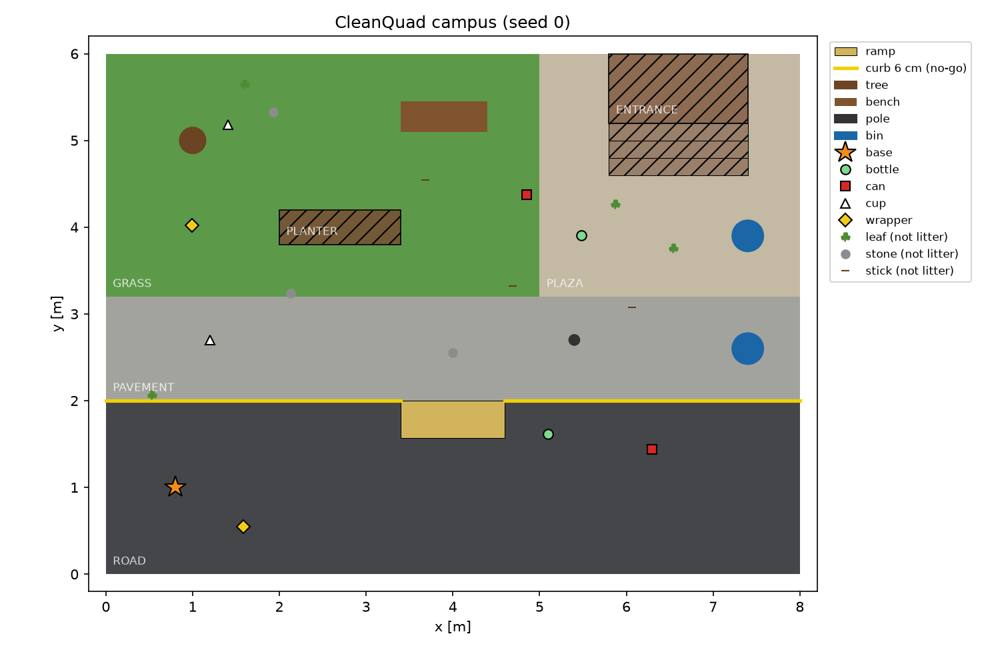
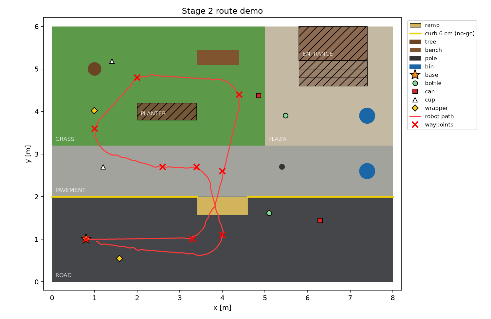
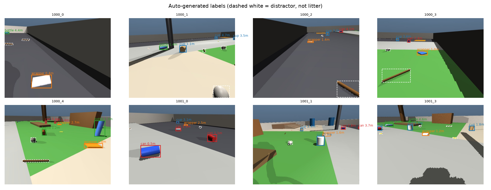
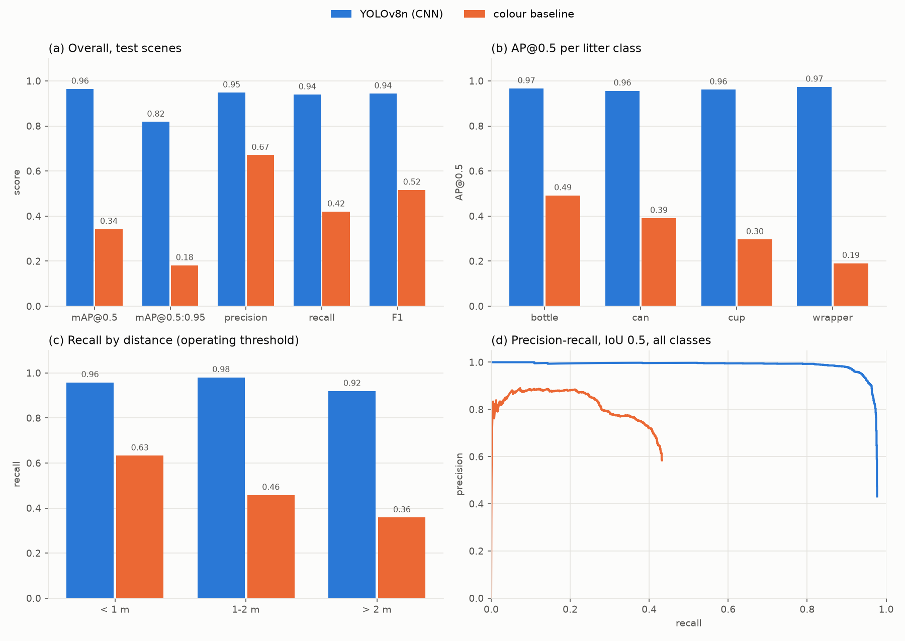
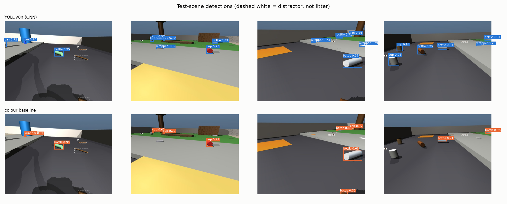

# CleanQuad — Progress Report, Stages 1–3

*Simulated Unitree A1 quadruped for campus litter collection (MuJoCo). Status as of 10 Oct 2026.*

| Stage | Title | Status |
|---|---|---|
| 1 | Quadruped locomotion | **Done** (V1 certified; V2 fast gait added and certified) |
| 2 | Campus / street environment | **Done** |
| 3 | Litter perception | **Done** (CNN + classical baseline, evaluated) |
| 4 | 3-D litter localization | Next |
| 5 | Semantic mapping | Planned |
| 6 | Autonomous navigation (RL navigator) | Planned |
| 7 | Cleaning / pickup | Planned |
| 8 | Task planning & optimization | Planned |

---

## 1. Stage 1 — Quadruped Locomotion

### 1.1 Approach
A model-based (non-learned) trot controller drives the 12 position actuators of the Unitree A1
(MuJoCo Menagerie model):

- **Trot gait generator.** Diagonal leg pairs swing alternately; each foot follows a swing/stance trajectory.
- **3-D leg inverse kinematics.** Converts each foot target into hip/thigh/calf angles.
- **Yaw stabilisation.** A proportional heading term keeps straight walking straight.
- **Velocity → stride calibration.** Measured tables map commanded `vx` to stride length, and `wz` to a left/right stride difference.
- **`LocomotionInterface(vx, wz)`.** The single entry point used by every later stage. Commands are clamped to the certified envelope, and the heading reference is re-anchored to the actual yaw whenever the command changes.

Two gait profiles are kept in `src/controllers/gait_profiles.py`:

| Profile | Step freq. | Foot lift | Speed envelope | Use |
|---|---|---|---|---|
| `V1_SLOW` (original) | 1 Hz | 3 cm | ≈ 0.03 m/s | Original certification (experiment 15); kept bit-identical |
| `V2_FAST` (default) | 4 Hz | 7 cm | vx −0.3 … 0.5 m/s, \|wz\| ≤ 0.5 rad/s | All Stage 2–3 work |

V2 was added because V1 was too slow for a campus task and could not climb even a 1 cm step.
Experiment 16 confirms that V1 still reproduces its original certification exactly.

### 1.2 V2 certification (experiment 21)
**Result: 16/16 required tests and 4/4 optional tests pass, with no falls.**

| Test | Target | Measured | Error |
|---|---|---|---|
| Forward | 0.10 / 0.30 / 0.50 m/s | 0.101 / 0.300 / 0.491 m/s | 0.7 / 0.2 / 1.8 % |
| Backward | −0.10 / −0.30 m/s | −0.099 / −0.299 m/s | 0.6 / 0.2 % |
| Curve | vx 0.3, wz ±0.5 rad/s | wz ±0.503 rad/s | 0.6 % |
| Rotate in place | wz ±0.3 rad/s | ±0.303 rad/s | ≤ 1.3 % |

- Maximum roll is 5.2° and maximum pitch is 3.4° across all tests.
- Stopping from 0.5 m/s coasts about 2 cm.

### 1.3 Terrain capability (experiment 18, V2 at 0.3 m/s)

| Feature | Pass | Unstable | Fail |
|---|---|---|---|
| Ramp up / down | 3°–15° all pass | — | — |
| Step **up** | 1 cm | 2–3 cm | ≥ 4 cm (falls or blocked) |
| Step **down** | 1–3 cm | 4–8 cm | — |
| Friction change (road → grass, μ 0.6) | pass | — | — |

**Design consequence:** curbs are treated as **no-go lines**, and level changes are reached through
an 8° ramp (a curb cut).

---

## 2. Stage 2 — Campus Environment



### 2.1 World
The campus is an 8 × 6 m area inspired by IIT-KGP, built procedurally with `MjSpec` in `src/environment/`.

- **Ground surfaces:**
  - Road at z = 0.
  - Pavement, grass and plaza raised **6 cm** behind a curb.
  - An **8° ramp** (curb cut) at x 3.4–4.6 m connecting the two levels.
- **No-go areas:** planter, stairs, building entrance.
- **Obstacles:** tree, bench, lamp pole, 2 dustbins.
- **Litter:** 4 classes (bottle, can, cup, wrapper), with randomised colour and size, lying or standing.
  Items are mocap bodies, so they can be "collected" (removed) in Stage 7.
- **Distractors:** leaves, stones and sticks. They are litter-like clutter that must *not* be detected.
- **Per-seed randomisation:** litter and distractor placement, plus lighting.
- **Map API:** `zone_at`, `ground_height_at` and `is_traversable` in `layout.py`, ready for Stage 5/6.

### 2.2 Integration test (experiment 19)
A scripted route of 9 waypoints goes road → ramp → pavement → grass around the planter → back down the ramp → home.



**Result: 9/9 waypoints in 63.4 s, no falls and no curb contacts.** The route was driven by a simple
heading follower with no planning; real navigation is Stage 6.

**Note on terrain contact:** each A1 leg touches the ground with both the foot and the calf
capsule. Giving the terrain a higher contact priority slowed the gait, so the terrain uses MuJoCo's
default contact with μ = 1.0 (and μ = 0.6 on grass).

---

## 3. Stage 3 — Litter Perception

### 3.1 Sensor
An RGB-D head camera is mounted on the trunk at (0.16, 0, 0.03) m and tilted 25° down.

- Image: 640 × 480, vertical field of view 70°.
- Outputs per frame: RGB, depth and a segmentation image.
- The camera's position and intrinsics are recorded with every frame, for Stage 4.

### 3.2 Dataset (experiment 22)
Labels are generated **automatically** from the simulator's segmentation render, so no manual
annotation is needed. An object counts as labelled if at least 40 visible pixels of it are in view.
Labels are in YOLO format.

| Split | Scenes (seeds) | Images | Purpose |
|---|---|---|---|
| train | 600 (1000–1599) | 3000 | Training |
| val | 100 (2000–2099) | 500 | Threshold tuning, early checks |
| test | 100 (3000–3099) | 500 | Final numbers only |

- Each scene is rendered from 5 robot viewpoints.
- Splits use disjoint seeds, so the test set contains completely unseen layouts.



### 3.3 Detectors (experiment 23)

| | **Main: YOLOv8n CNN** | **Baseline: classical colour** |
|---|---|---|
| Method | COCO-pretrained YOLOv8n, fine-tuned | HSV colour-histogram Bayes classifier, then connected blobs, then a per-blob class vote |
| Training | 50 epochs, 640 px, batch 16, about 74 min on a GTX 1650 (4 GB) | A few seconds (histograms from training masks) |
| Model | `models/litter_yolov8n.pt` | `models/color_baseline.npz` |

### 3.4 Results on the test set (experiment 24)
For each detector, the operating threshold is the confidence that maximises F1 on the **validation** split.
Boxes count as matched at IoU ≥ 0.5.

| Metric | **YOLOv8n (CNN)** | Colour baseline |
|---|---|---|
| mAP@0.5 | **0.965** | 0.342 |
| mAP@0.5:0.95 | **0.818** | 0.181 |
| Precision | **0.948** | 0.671 |
| Recall | **0.939** | 0.420 |
| F1 | **0.944** | 0.516 |
| False positives / image | **0.22** | 0.86 |
| False positives on distractors / image | **0.00** | 0.02 |
| Latency (per image) | **8 ms** (148 img/s, GPU) | 133 ms (7.6 img/s, CPU) |

AP@0.5 per class:

| Class | CNN | Baseline |
|---|---|---|
| bottle | 0.967 | 0.491 |
| can | 0.956 | 0.391 |
| cup | 0.962 | 0.296 |
| wrapper | 0.974 | 0.191 |

Recall by distance:

| Distance | CNN | Baseline |
|---|---|---|
| < 1 m | 0.958 | 0.633 |
| 1–2 m | 0.980 | 0.458 |
| > 2 m | 0.919 | 0.358 |




**Interpretation:**
- **The colour baseline works only when colour is unique.** Colour alone cannot separate litter
  from same-coloured scenery or other litter classes. It is weakest on wrappers and cups, whose
  colours vary most, and it degrades quickly with distance as objects shrink to a few pixels.
- **The CNN uses shape and context.** It stays above 0.9 recall even beyond 2 m and ignores the
  distractors completely.
- **This justifies using ML here.** The classical method is clearly insufficient, which satisfies
  the brief's rule "classical baseline first, ML only where it measurably helps".

### 3.5 Closed-loop demo (experiment 25)
The robot walks the Stage 2 route while running the detector on its head camera at 5 Hz.
Each frame is scored against ground truth from segmentation.

| | CNN | Colour baseline |
|---|---|---|
| Litter items detected (of 8 in view) | **8 / 8** | 6 / 8 |
| Frame-level precision / recall | **0.976 / 0.976** | 0.792 / 0.679 |
| Detector rate | 71.6 frames/s | ≈ 7 frames/s |

Animations: `results/videos/perception_demo_cnn.gif` and `results/videos/perception_demo_color.gif`.

### 3.6 Known limitations
1. **Blue dustbins are sometimes detected as "can".** Bins were never labelled as negatives. Fix:
   add a `bin` / "not litter" class, or more bin views, to the dataset.
2. **Simulation-to-real gap.** The model is trained and tested only on rendered images, so these
   numbers do not transfer to a real camera.
3. **Detection is 2-D only.** World positions come in Stage 4.

---

## 4. How to Reproduce

Use the Anaconda `python3`; the repo's own venv is broken. Run from `Robot-Autonomy/`:

```bash
python3 experiments/16_locomotion_interface_check.py   # V1 unchanged
python3 experiments/21_fast_locomotion_test.py         # V2 certification
python3 experiments/18_terrain_traversal_test.py       # curbs / ramps
python3 experiments/17_view_campus.py                  # look at the campus (viewer)
python3 experiments/19_campus_route_demo.py --viewer   # robot walks the route
python3 experiments/22_generate_dataset.py             # ~4000 labelled images
python3 experiments/23_train_detectors.py              # baseline + YOLOv8n (~75 min)
python3 experiments/24_evaluate_detectors.py           # tables + figures above
python3 experiments/25_perception_demo.py              # live demo (add --detector color)
```

Outputs:
- `results/figures/`: figures.
- `results/logs/`: CSV logs.
- `results/videos/`: animations.
- `models/`: trained detectors.

---

## 5. Next Steps

### Stage 4 — 3-D litter localization (immediate next)
**Goal:** turn each detection box into a world position (x, y, z) of the litter item.

1. **Back-project each box.** Take the median depth inside the box, then use the camera intrinsics
   to get a 3-D point in the camera frame. The camera position and orientation from the frame
   (`cam_pos`, `cam_mat`) convert that to world coordinates.
2. **Fuse detections over time.** Merge detections of the same object across frames with nearest-
   neighbour association, keeping a running mean and a confidence count, so each item appears once
   in the map.
3. **Evaluate against ground truth.** The simulator knows every item's true position. Metrics:
   - Localization error (mean and 95th percentile, in cm), overall and by distance.
   - Duplicate rate and missed-item rate after a full route.
4. **Ablation:** compare depth from the depth camera with a flat-ground ray-cast that uses no depth.
   This is a cheap classical comparison that fits the report.
5. **Optional:** add the `bin` negative class and retrain (about 75 min), to remove the
   bin-as-can error before mapping.

**Done when:** after one route walk, every visible litter item is in a list with its world
position (error below about 10 cm) and its class.

### Later stages (planned design)
- **Stage 5 — Semantic map.** A 2-D grid storing occupancy and terrain type from `layout.py`, plus the
  litter list from Stage 4, with class, confidence and collected / uncollected state.
- **Stage 6 — Navigation.**
  - Classical global planner: A* on the map.
  - **RL (PPO) local navigator**, trained in a fast 2-D abstraction that uses the certified
    (vx, wz) envelope, then tested in MuJoCo against the classical planner.
- **Stage 7 — Pickup.** A simulated scoop or suction action: when the robot is close enough, the
  litter body is removed (`Campus.collect`) and the map is updated.
- **Stage 8 — Task planning.** Choose the next item by distance, terrain risk and priority; add
  battery and storage limits that force returns to base.

### Housekeeping
- `README.md` is empty. Add a short project overview and the run commands from §4.
- Put the project under git (`git init`) before Stage 4, so each stage can be tagged.
