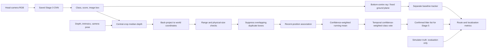

# Stage 4: 3-D litter localization pipeline

**Status: complete for the verified CNN seed-0 headless route, as of 10 October
2026.** The existing completion criterion is satisfied. A subsequent saved
full viewer route on seed 0 also passes. Additional seeds remain unverified.

The localization milestone in the
[overall progress report](PROGRESS_REPORT_STAGES_1-3.md) is a list of visible
litter items with class and world position after a campus route, with position
error below about 10 cm.
Stage 4 connects the existing detector and RGB-D camera to a persistent litter
tracker and a separate simulator evaluator.

## Pipeline



1. Walk the existing nine-waypoint campus route with `LocomotionInterface`.
2. Capture synchronized RGB, depth, camera pose, and intrinsics at 5 Hz.
   The runner refreshes MuJoCo kinematics after each sampled physics step.
3. Apply the detector operating threshold from Stage 3's validation results
   (`0.38` for the CNN).
4. Estimate world points using depth, and independently using a flat-ground
   ray intersection as the no-depth baseline.
5. Suppress weaker duplicate detections when estimated positions agree within
   8 cm and either image IoU is at least 0.5 or at least 85% of the smaller box
   overlaps the larger box. This also catches small fragment detections whose IoU
   is low. Separate image boxes and boxes at different depths remain separate.
   Associate same-class observations within 20 cm; allow a changed class within
   the stricter 8 cm gate. The association distance uses the closer of the fused
   mean and the last surface observation when that observation is at most one
   second old. The fused mean must still lie within the 20 cm association gate.
   This prevents a fresh false track from taking observations just because the
   established track's long-term mean differs from the current visible surface.
   Confirmed tracks win distance ties. Assign at most one observation per track
   per frame. Fuse positions using detection confidence as the weight, and choose
   the class with the largest accumulated confidence.
6. Confirm tracks after three separate frames supporting the winning class;
   three observations with mixed labels alone are insufficient. Tentative tracks
   expire after three seconds without another observation. Once confirmed,
   stationary tracks persist for the route, including during class changes.
   Reset the pipeline for a new episode.
7. Export the litter list, score it against simulator truth, and save figures.

Runtime localization and fusion never use segmentation masks, object identities,
object positions, or the campus terrain map. Segmentation determines which
objects were visible and supplies 2-D evaluation labels in the experiment.
Camera pose comes from the simulator; estimating robot pose is outside Stage 4.

## Geometry and assumptions

Depth is axial distance along the camera's viewing direction, in metres.
For pixel `(u, v)` with depth `d`, the MuJoCo camera-frame point is:

```text
p_camera = [(u - cx) * d / fx, -(v - cy) * d / fy, -d]
p_world  = cam_mat @ p_camera + cam_pos
```

The depth estimator samples the central 60% of the box in each dimension,
removes nonfinite and out-of-range depths, and takes the median. At least nine
valid samples are required. It projects the box centre using that median depth.
The point represents the visible object surface; error against the true object
centre therefore includes surface bias.

The baseline intersects the bottom-centre camera ray with `z = 0`. It reads
neither depth nor terrain height. Raised pavement and grass are consequently
expected to expose its flat-ground assumption.

Both estimators reject estimated camera ranges outside 5 cm–8 m and projected
physical extents above 35 cm. The extent check targets scenery such as the
known bin-as-can detections, without reading simulator labels. These parameters
are configurable in the experiment. Close items of the same class, persistent
detector mistakes, poor boxes, and contaminated depth can still create mapping
errors; the evaluator reports them rather than silently discarding them.

## Run and inspect

Run from the repository root using a working Python environment containing
`requirements.txt` dependencies. A working MuJoCo OpenGL context is required;
the default route runs without an interactive viewer.

```bash
# Geometry, fusion, and metric regression tests
python -m unittest discover -s tests -v

# Full perception-to-localization route; exit nonzero when the target fails
python experiments/26_localization_pipeline.py --detector cnn --seeds 0 --require-pass

# Repeat on different layouts using identical parameters
python experiments/26_localization_pipeline.py --detector cnn --device cpu --seeds 0 1 2 --require-pass

# Optional route animation
python experiments/26_localization_pipeline.py --detector cnn --seeds 0 --save-video

# Live campus viewer with confirmed litter markers
python experiments/26_localization_pipeline.py --detector cnn --device cpu --seeds 0 --viewer --require-pass

# Isolate geometry using simulator 2-D boxes (diagnostic, not CNN validation)
python experiments/26_localization_pipeline.py --detector oracle --seeds 0 --require-pass

# Existing classical colour detector can use the same pipeline
python experiments/26_localization_pipeline.py --detector color --seeds 0
```

`--methods depth ground_plane` is the default. Other useful options are
`--threshold`, `--association-radius`, `--class-switch-radius`, `--min-observations`, `--depth-crop`,
`--max-extent`, `--ground-z`, `--rate`, `--max-time`, `--output`, and
`--no-figures`. `--require-pass` checks the depth pipeline and requires the
depth method to be selected. An oracle run only validates localization and
tracking with perfect 2-D boxes; it does not certify CNN performance.

Outputs are under `results/logs/localization/<detector>/`:

| File | Contents |
| --- | --- |
| `summary.csv` | One row per seed and estimator; route status, errors, duplicates, misses, and pass status |
| `seed_N/run.json` | Run settings, dependency versions, model checksum, and diagnostic-mode flag |
| `seed_N/depth/tracks.json` | Confirmed class-labelled positions, class votes, confidence, observation count, timestamps, and position spread |
| `seed_N/depth/metrics.json` | Overall and distance-bin errors, map counts, rejections, and route completion |
| `seed_N/depth/observations.csv` | Accepted observations and evaluation errors; unmatched detections have no true-position error |
| `seed_N/depth/map_matches.csv` | One-to-one final-map matches with their position errors |
| `seed_N/ground_plane/…` | Identical outputs for the baseline |
| `seed_N/route.csv` | Sampled robot trajectory |
| `seed_N/map.png`, `errors.png` | Fused map comparison and observation-error plots |
| `seed_N/localization.gif` | Optional camera animation |

## Metrics and completion gate

All position errors are Euclidean 3-D distances to the simulator object centre,
reported in centimetres. XY error is also logged. Observation errors are scored
only for same-class detections matching a visible ground-truth box at IoU ≥ 0.5.
They are reported overall and for true camera-to-object distances `<1 m`,
`1–2 m`, and `≥2 m`.

Final-map evaluation uses maximum-cardinality, same-class, one-to-one matching
inside a 25 cm 3-D gate. An unmatched track with a candidate true object is a
duplicate; a track with no candidate is a false positive. Missed items are
visible true objects without a final match. Duplicate rate divides by confirmed
tracks, and missed-item rate divides by visible true objects. A bad estimate
beyond the gate counts as a false positive and a miss, so matched-only error
statistics cannot hide it from the completion check.

The depth run passes only if the robot completes all nine waypoints without a
fall, at least one litter item was visible, every visible item is matched,
there are no duplicates or false positives, and **every matched position is
within 10 cm**. Empty maps and incomplete routes cannot pass. The flat-ground
baseline is evaluated using the same criteria but its failure does not prevent
the depth experiment from succeeding.

## Duplicate-track failure and mitigation

An earlier full CNN seed-0 run reached all nine waypoints without falling and
matched all eight visible items, but produced **nine confirmed tracks**. Tracks
2 and 8 represented the same bottle, so the evaluator reported one duplicate
and failed the completion criterion. The final matched positions were already
within 10 cm; the failure concerned object identity.

### Failure sequence and root cause

At approximately 18.0 seconds, the detector emitted both a bottle observation
for established track 2 and an extra wrapper observation nearby. The wrapper
score was about 0.385, just above the 0.38 operating threshold. Since both
observations survived the box filter and a track can accept only one
observation per frame, the extra observation started tentative track 8.

At 18.2 and 18.4 seconds, the old association logic assigned subsequent bottle
observations to track 8. It compared observations only with each track's fused
position. Changing viewpoints shift the visible surface point, so track 2's
long-term average was farther away than the fresh false track. After these
assignments, track 8 had three observations in total and its confidence-weighted
class vote changed to bottle. The old confirmation rule counted all three
observations, although only two supported bottle. That made the duplicate
permanent. The previous 24-test suite had not covered this sequence.

The earlier failed output was overwritten by the final rerun. Its failure
sequence is preserved in the regression test, while the saved corrected
[observation log](../results/logs/localization/cnn/seed_0/depth/observations.csv)
shows the 18.2 and 18.4 second bottle observations assigned to **track 2**.
The false wrapper still starts tentative track 8 at 18.0 seconds, but receives
no further observations and expires. It is absent from the final
[confirmed litter list](../results/logs/localization/cnn/seed_0/depth/tracks.json).

### Mitigation

| Change | Mechanism and purpose |
| --- | --- |
| Recent-position association | Use the closer of the fused position and the last observation when that observation is at most one second old. Keep the 20 cm gate around the fused mean, and the stricter 8 cm gate for class changes. This keeps observations of the current visible surface attached to the established identity. Confirmed tracks win distance ties. |
| Repeated class support before confirmation | Require three separate frames supporting the current winning class. One wrapper plus two bottle observations cannot confirm a bottle. Tentative tracks expire after three seconds without another observation; confirmation persists once earned. |
| Fragment-box suppression | Suppress a weaker detection only when its world position agrees within 8 cm and either IoU is at least 0.5 or intersection covers at least 85% of the smaller box. This adds a guard for nested fragments that can have low IoU. Different image regions and detections at different depths remain distinguishable. |

The association and confirmation changes address the observed bottle failure.
The fragment rule covers an additional duplicate-box case demonstrated by the
tests; the original run did not log enough image-box history to identify its
extra wrapper as a nested fragment. Runtime decisions use detections, depth,
camera pose, and track history. Simulator truth remains restricted to
evaluation. The fix preserves identities during association and confirmation;
it does not merge every pair of nearby tracks or relax the completion gate.

### Regression tests

The following cases are in [tests/test_localization.py](../tests/test_localization.py):

| Regression | Required behavior |
| --- | --- |
| `test_extra_wrapper_cannot_steal_established_bottle_identity` | Reproduces the recorded positions and scores around 18 seconds. Later bottle observations keep the original identity; the extra wrapper expires, leaving one confirmed bottle. |
| `test_confirmation_requires_repeat_support_for_winning_class` | Mixed-label observations stay tentative until the winning class has support from three frames. |
| `test_unconfirmed_mixed_labels_expire` | Three mixed-label observations cannot keep an unconfirmed track alive indefinitely. |
| `test_nested_fragment_box_is_suppressed_despite_low_iou` | A weaker nested fragment at the same depth is removed even when its IoU is below 0.5. |
| `test_nearby_real_bottle_can_receive_observations_without_old_bottle` | A separate nearby bottle retains its identity when the older bottle is no longer observed. |
| `test_nearby_simultaneous_items_keep_separate_tracks_across_classes` | Two nearby real objects with different classes remain separate across frames. |
| `test_same_frame_cannot_confirm_or_collapse_two_items` | Same-frame detections neither confirm a track prematurely nor collapse two objects. |
| `test_separate_image_boxes_survive_duplicate_filter` | Partially overlapping but separate boxes survive the filter. |
| `test_nested_boxes_at_different_depths_remain_separate` | Image containment alone cannot suppress objects at different depths. |
| `test_old_surface_observation_does_not_override_map_after_long_gap` | Old surface observations lose their association influence after the recent-observation window. |

Seven tests were added, bringing the suite from 24 to **31**. Four of the new
tests failed against the old implementation: identity preservation, repeated
class support, tentative expiry for mixed labels, and nested-fragment filtering.
All 31 passed after the fix. The full CNN rerun then passed independently.

## Verified result

The saved CPU CNN run on 10 October 2026 used seed 0, the saved Stage 3 weights,
and the default parameters above. Its metadata records `viewer_enabled: false`.
It completed all nine waypoints without a fall, processing 318 frames over
63.412 simulated seconds in approximately four minutes of wall time.

| Final-map metric | Depth | Flat-ground baseline |
| --- | --- | --- |
| Visible items mapped | 8/8 | 7/8 |
| Confirmed tracks | 8 | 19 |
| Mean position error | 3.36 cm | 10.11 cm |
| P95 position error | 4.89 cm | 19.04 cm |
| Maximum position error | 4.92 cm | 19.70 cm |
| Duplicate tracks | 0 | 0 |
| False positives | 0 | 12 |
| Missed items | 0 | 1 |
| Completion criterion | Passed | Failed |

The full command with `--require-pass` returned exit code 0. The depth
observation errors were 3.86 cm mean and 6.53 cm P95; the completion gate
checks the fused final map, not every individual observation.

All 31 unit tests passed. New regressions reproduce the extra-wrapper/bottle
identity failure, require repeated class support before confirmation, and
check that nearby real objects and nested boxes at different depths survive.
This result validates seed 0; the optional multiple-seed command has not been
run. Saved evidence is the [summary](../results/logs/localization/cnn/summary.csv),
[depth metrics](../results/logs/localization/cnn/seed_0/depth/metrics.json),
[final map matches](../results/logs/localization/cnn/seed_0/depth/map_matches.csv),
and [run metadata](../results/logs/localization/cnn/seed_0/run.json), which includes
the model checksum, dependency versions, and association/confirmation settings.

### Validation scope

| Check | Verified scope |
| --- | --- |
| Full CNN headless route | Seed 0, 318 frames, 9/9 waypoints, no fall, depth completion criterion passed. |
| Unit tests | Last executed suite: 31 tests passed, including the duplicate regressions above. |
| Live viewer startup | A deliberately short CNN run with `--viewer --max-time 0.6` opened the window and exercised confirmed-marker rendering. Its temporary metadata records 0.6 simulated seconds, four frames, and 0/9 waypoints. It was a startup check, not a complete route; its partial map cannot certify Stage 4. |
| Subsequent full CNN viewer route | Saved separately under `results/logs/localization_viewer/cnn/seed_0/`. Metadata records `viewer_enabled: true`, 318 frames, 9/9 waypoints, no fall, and about 408 seconds wall time. Depth maps 8/8 items with eight confirmed tracks, zero duplicates/misses/false positives, maximum error 4.92 cm, and `stage4_passed: true`. |
| Flat-ground baseline | Evaluated on the same full seed-0 route and failed; this is the recorded ablation result and does not block depth completion. |
| Still unverified | Additional CNN seeds, real-camera transfer, uncertain robot pose, moving litter, and Stage 5 semantic-map integration. |

The viewer startup record was written under
`/tmp/cleanquad-stage4-viewer-smoke/cnn/seed_0/run.json` in WSL, separate from
the repository's verified full-route results. Temporary files may not persist
across environment cleanup.

The subsequent full viewer result is supported by its
[depth metrics](../results/logs/localization_viewer/cnn/seed_0/depth/metrics.json),
[run metadata](../results/logs/localization_viewer/cnn/seed_0/run.json), and
[summary CSV](../results/logs/localization_viewer/cnn/summary.csv). The earlier
startup check and this complete run are separate validation records.

## Stage 5 integration

```python
from src.localization import LocalizationPipeline

pipeline = LocalizationPipeline()
for frame in camera_frames:
    detections = detector.detect(frame.rgb)
    result = pipeline.update(frame, detections)

litter_list = [track.as_dict() for track in pipeline.tracker.confirmed_tracks]
```

Positions and their component-wise standard deviations are in world-frame
metres. Standard deviation describes observation spread, not calibrated
uncertainty of the mean. `class_observations` counts frames supporting the chosen
class; `class_confidence` is its share of accumulated detector scores, not a
calibrated probability. Stage 5 can attach occupancy, terrain, and
collected/uncollected state to these records. Stage 4 assumes stationary litter
and known camera pose; it does not yet implement semantic grids, navigation
planning, or pickup.

Begin Stage 5 with the verified depth `tracks.json` and the campus layout.
The [Stage 5 semantic mapping plan](STAGE_5_SEMANTIC_MAPPING_PLAN.md) specifies
the input contract, relevant files, first implementation steps, deliverables,
and proposed acceptance criteria. Semantic mapping remains planned; Stage 4's
completion does not imply that a semantic grid has already been implemented.

## Local Windows/WSL execution

Validation in this checkout uses an isolated CPU Python environment at
`/tmp/cleanquad-stage4-venv` in the `kali-linux` WSL distribution. Missing
OpenCV runtime libraries are extracted under `/tmp/cleanquad-stage4-libs`;
system Python and system packages were not changed. From PowerShell in the
repository root, reuse that environment with:

```powershell
Set-Location -LiteralPath 'C:\Users\ariji\Downloads\Robot Autonomy\Robot-Autonomy'

# Unit tests
wsl -d kali-linux -- /tmp/cleanquad-stage4-venv/bin/python -B -m unittest discover -s tests -v

# Full CNN route and completion check
wsl -d kali-linux -- env `
  LD_LIBRARY_PATH=/tmp/cleanquad-stage4-libs/usr/lib/x86_64-linux-gnu `
  YOLO_OFFLINE=true `
  YOLO_CONFIG_DIR=/tmp `
  MPLCONFIGDIR=/tmp/cleanquad-stage4-matplotlib `
  /tmp/cleanquad-stage4-venv/bin/python -B `
  experiments/26_localization_pipeline.py --detector cnn --device cpu --seeds 0 --require-pass
```

The generic commands above apply to any working environment with the repository
dependencies and MuJoCo rendering support installed. The local WSL environment
is temporary and is separate from the repository's existing virtual environments.

To run Stage 4 with a live viewer from PowerShell, use the same environment and
add `--viewer`. The following command keeps viewer-run outputs separate from
the verified headless results:

```powershell
wsl -d kali-linux -- env `
  LD_LIBRARY_PATH=/tmp/cleanquad-stage4-libs/usr/lib/x86_64-linux-gnu `
  YOLO_OFFLINE=true `
  YOLO_CONFIG_DIR=/tmp `
  MPLCONFIGDIR=/tmp/cleanquad-stage4-matplotlib `
  /tmp/cleanquad-stage4-venv/bin/python -B `
  experiments/26_localization_pipeline.py --detector cnn --device cpu --seeds 0 `
  --viewer --require-pass --output results/logs/localization_viewer
```

The viewer opens a campus overview. Blue markers show confirmed litter
positions. Simulation is paced to at most real time, but CPU detection and
rendering may make it slower. Drag and scroll in the viewer to change the view.
The window closes when the route finishes. Closing it early stops the run and
saves partial results, which cannot pass the completion check. The live viewer
requires the WSL desktop display used by the existing MuJoCo setup.
