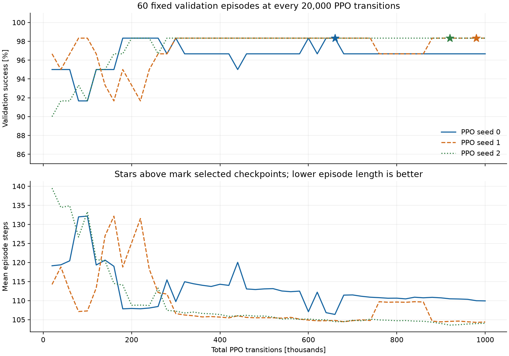
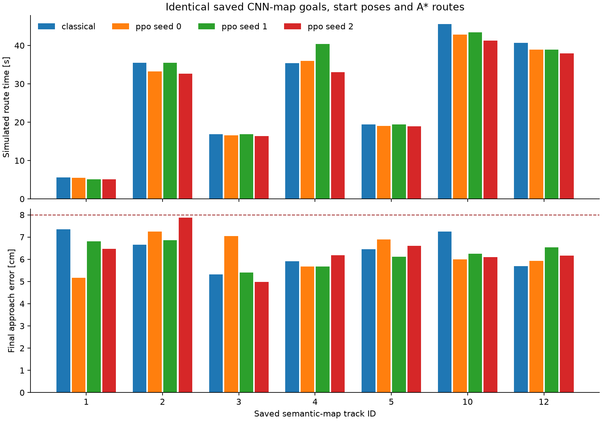
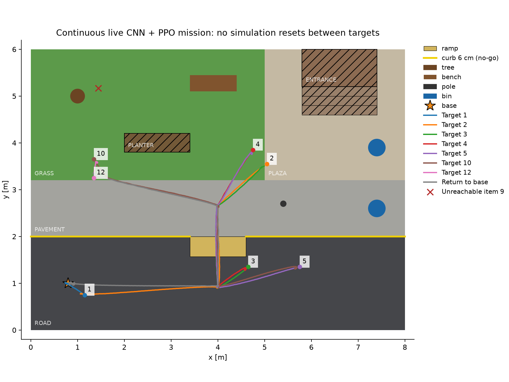

# Stage 6 final report: map planning and learned navigation

The Stage 6 navigation pipeline is implemented and verified within the static-campus simulation scope below. Three PPO models each completed **1,001,472 environment transitions**. **300/300** policy/test-case executions succeeded on 100 common fresh local-navigation cases. The full MuJoCo comparison passed **59/59** distinct executed routes. The continuous live CNN/PPO mission visited **7/7 reachable prior-map targets**, classified **1 unreachable target**, and returned to base with the viewer enabled. **93 regression tests passed**.

The 120,000-transition pilot was an initial experiment. The final budget is one million requested PPO transitions **per seed**, rounded to the next complete 2,048-transition rollout. More transitions do not guarantee a better policy; deployment uses the checkpoint selected by validation, then tests that frozen policy on separate cases.

## 1. Delivered pipeline

```mermaid
flowchart LR
  RGB[Robot RGB + depth] --> CNN[Existing YOLO litter detector]
  CNN --> Loc[Depth localization and confirmed tracks]
  Loc --> Bridge[Fresh-run identity reconciliation]
  Prior[Saved Stage 5 semantic map] --> Bridge
  Bridge --> Map[Mission semantic map]
  Map --> Goal[Reachable standoff pose]
  Goal --> AStar[Clearance-aware A* and ramp portals]
  AStar --> Obs[Local waypoint + measured motion + map rays]
  Obs --> PPO[Trained PPO speed and turn controller]
  PPO --> Guard[Velocity limits, arrival guard, trajectory filter]
  Guard --> Gait[Existing LocomotionInterface]
  Gait --> Sim[MuJoCo quadruped]
  Sim --> RGB
  Sim --> Obs
  Sim --> Check[Contacts, clearance, attitude and settling checks]
```



Stage 6 selects and reaches a safe approach pose. It uses a known static obstacle/terrain map, simulator robot pose, A* global waypoints, and a learned local controller. RGB-D detections refine item positions during the continuous mission. Simulator litter truth is used only for diagnostic target placement in scenes 1/2 and post-mission map scoring. Physical pickup belongs to Stage 7; mission ordering, storage and battery planning belong to Stage 8. Fixed track-ID order is used here for reproducible navigation testing.

| Component | Implemented behavior | Source |
| --- | --- | --- |
| Global planner | Eight-neighbour A*, no diagonal corner cutting, exact segment checks, ramp portals, safe approach candidates | `src/navigation/planner.py` |
| Classical baseline | Deterministic waypoint speed/heading feedback | `src/navigation/follower.py` |
| Shared observation/action contract | 25 normalized values; continuous forward and yaw commands | `src/navigation/observations.py` |
| RL environment | Fast randomized 2-D local-goal dynamics and explicit success/collision/timeout outcomes | `src/navigation/rl_env.py` |
| Learned deployment | Deterministic PPO inference for translation and steering; explicit final stop/alignment guard | `src/navigation/ppo_navigator.py` |
| Safety and execution | Identical map trajectory filter for both controllers; independent physical contact and attitude checks | `src/navigation/evaluation.py` |
| Live map adapter | New run namespace, class/position association, persistent collection state, atomic updates | `src/navigation/live_map.py` |
| Experiments | Baseline 28; training 29; comparison 30; live/viewer 31; report 32 | `experiments/` |

No classical-controller fallback is used for a PPO route. The final arrival guard forces zero translation inside the goal disk; PPO still supplies alignment steering until the final heading meets tolerance. A* waypoint geometry and the shared safety filter remain part of the system, so its performance is that of **A* + PPO + guards**, rather than an image-to-motor or unshielded end-to-end policy.

## 2. A* baseline and why PPO was chosen

A* searches the traversable grid using accumulated travel cost plus an estimated remaining distance. The baseline consists of this planner followed by the classical controller. A* remains the global planner in the learned system; PPO replaces the local speed/turn feedback. Both systems use the same starts, target poses, padding, ramp waypoints, locomotion interface and acceptance thresholds.

PPO supports the continuous two-value command action and a small CPU MLP. Its clipped policy objective limits large policy changes during each update, and its rollout/minibatch implementation is practical for this project. These properties are described in the [original PPO paper](https://arxiv.org/abs/1707.06347) and [official Stable-Baselines3 documentation](https://stable-baselines3.readthedocs.io/en/master/modules/ppo.html). The CPU choice also follows the library's guidance for MLP PPO. This is an engineering choice, not a demonstrated claim that PPO is the best possible algorithm; SAC/TD3 and direct MuJoCo training were not benchmarked.

The certified high-level command envelope is forward speed **0 to 0.30 m/s** and yaw rate **±0.30 rad/s**. Translation below 0.05 m/s and yaw magnitudes below 0.015 rad/s are set to zero. This preserves the existing locomotion layer while making RL learn when to translate, slow down and turn.

## 3. Training environment and RL update

1. Sample a free start, a locally visible subgoal 0.15–1.8 m away, initial yaw and final orientation on the padded campus map. Seventy percent of episodes train a final approach; the remainder train intermediate waypoint arrival.
2. Encode local target x/y, distance, sine/cosine bearing error, sine/cosine final-heading error, alignment/final flags, measured forward/yaw velocity, ramp/height features and 12 obstacle rays. Rays come from the known map, with 24 distance samples out to 2 m; they are not physical lidar readings. The policy uses measured motion and has no recurrent state.
3. Sample the PPO actor's two continuous normalized actions and decode them into the locomotion command envelope. The 2-D model advances at **10 Hz**, with command lag 0.10–0.22 s, a one-second gait startup blend, ±4% speed scaling, ±3% yaw scaling and yaw bias ±0.008 rad/s randomized per episode. These are modeling assumptions, not full robot physics.
4. Compute reward: `12 × distance progress - 0.015` per step, plus `0.5 × heading progress` near a final goal; subtract `0.004 × bearing error` and `0.001 × squared action change`. Collision adds **−25**; success adds **+20**.
5. End an episode on collision or success. A final approach requires ≤8 cm position error, ≤6° heading error and forward speed <0.02 m/s for five steps. An intermediate waypoint requires ≤4 cm error. A 450-step time limit is a truncation, with Gymnasium/SB3 handling bootstrap semantics.
6. Collect 1,024 steps from each of two synchronous vector environments: **2,048 total transitions per PPO rollout**. Estimate value targets and generalized advantages, then optimize the clipped policy surrogate and critic over five minibatch epochs. Rollouts are collected using the current policy; no replay buffer is used.
7. Evaluate every 20,000 transitions on the same 60 validation seeds, save the best positive-PPO-step checkpoint, and evaluate that frozen model on 100 separate fresh test seeds. Deploy the saved checkpoint in MuJoCo with deterministic actions and physical safety measurements.

The clipped actor objective is `mean(min(ratio × advantage, clip(ratio, 1−0.15, 1+0.15) × advantage))`, where `ratio` compares new and rollout-policy action probabilities. The learned critic estimates discounted return to support advantage estimation. PPO learns from the navigation reward after initialization; the teacher is not called during deployment.

| Setting | Value used |
| --- | --- |
| Runtime | CPU, two PyTorch threads, two `DummyVecEnv` environments (synchronous, not subprocess workers) |
| Actor and critic | Separate MLP branches, each two hidden layers of 64 units |
| Learning rate | 0.00003 |
| PPO rollout / minibatch / epochs | 1,024 steps per environment / 256 / 5 |
| Discount / GAE lambda | 0.995 / 0.95 |
| Clip range / target KL | 0.15 / 0.02 |
| Entropy coefficient | 0 |
| Validation seeds | 9000–9059; 60 randomized episodes per checkpoint |
| Fresh test seeds | 25000–25099; 100 randomized episodes per selected model |
| Requested / actual budget | 1,000,000 / 1,001,472 transitions per seed |

An imitation initializer was trained for the pilot using 24,000 teacher-labeled observation samples and 60 supervised epochs; this is separate from PPO transitions. The extended runs all start from the **same pilot seed-0 imitation checkpoint**, with fresh PPO optimizers, fresh PPO counters and separate PPO random seeds 0/1/2. They are three PPO runs, not three independently generated imitation datasets. Initial actor log standard deviation is −3. The warmup validation stored in each manifest uses nominal dynamics; checkpoint validation and final tests use randomized dynamics, so the warmup rate is not placed on the same learning curve.

## 4. Transitions versus success rate

Success below means local-goal success in the **unshielded 2-D validation environment**, not the seven-target MuJoCo mission. A 2-D collision means intersecting the conservative padded map model; physical robot contacts are measured separately in MuJoCo. Each percentage has denominator 60; one episode changes the rate by 1.67 percentage points. The validation set is reused for checkpoint selection. The fresh test set is separate, but all policies share the same 100 test seeds on the same campus topology; these are 300 policy/case executions over 100 unique seeded scenarios.

| Seed | Actual PPO transitions | Selected checkpoint | Selected validation success | Fresh test success | Training wall min |
| --- | --- | --- | --- | --- | --- |
| 0 | 1,001,472 | 660,000 | 59/60 (98.33%) | 100/100 (100.00%) | 14.50 |
| 1 | 1,001,472 | 980,000 | 59/60 (98.33%) | 100/100 (100.00%) | 13.48 |
| 2 | 1,001,472 | 920,000 | 59/60 (98.33%) | 100/100 (100.00%) | 23.04 |

| PPO transitions | Seed 0 success | Seed 1 success | Seed 2 success |
| --- | --- | --- | --- |
| 20,000 | 57/60 (95.00%) | 58/60 (96.67%) | 54/60 (90.00%) |
| 40,000 | 57/60 (95.00%) | 57/60 (95.00%) | 55/60 (91.67%) |
| 60,000 | 57/60 (95.00%) | 58/60 (96.67%) | 55/60 (91.67%) |
| 80,000 | 55/60 (91.67%) | 59/60 (98.33%) | 56/60 (93.33%) |
| 100,000 | 55/60 (91.67%) | 59/60 (98.33%) | 55/60 (91.67%) |
| 120,000 | 57/60 (95.00%) | 58/60 (96.67%) | 57/60 (95.00%) |
| 160,000 | 57/60 (95.00%) | 55/60 (91.67%) | 58/60 (96.67%) |
| 200,000 | 59/60 (98.33%) | 56/60 (93.33%) | 59/60 (98.33%) |
| 300,000 | 59/60 (98.33%) | 59/60 (98.33%) | 59/60 (98.33%) |
| 400,000 | 58/60 (96.67%) | 59/60 (98.33%) | 59/60 (98.33%) |
| 500,000 | 58/60 (96.67%) | 59/60 (98.33%) | 59/60 (98.33%) |
| 600,000 | 59/60 (98.33%) | 59/60 (98.33%) | 59/60 (98.33%) |
| 700,000 | 58/60 (96.67%) | 59/60 (98.33%) | 59/60 (98.33%) |
| 800,000 | 58/60 (96.67%) | 58/60 (96.67%) | 59/60 (98.33%) |
| 900,000 | 58/60 (96.67%) | 59/60 (98.33%) | 59/60 (98.33%) |
| 1,000,000 | 58/60 (96.67%) | 59/60 (98.33%) | 59/60 (98.33%) |



The curves are measured and can move down as well as up. The final one-million-transition checkpoint is not automatically the deployed checkpoint. Selection maximizes `success_rate − collision_rate − mean_steps / 100000`; only a checkpoint with positive PPO transitions is eligible. The validation collision rate is 1.67% at the final seed-0 checkpoint, which is why real deployment retains a common safety filter. A 100% fresh test score does not prove collision-free behavior for arbitrary starts or unseen environments.

Checkpoint transition counters include interactions collected so far. Evaluation callbacks run during a rollout, so a checkpoint's latest policy optimization precedes that exact counter boundary. `final.zip` is saved after the final complete rollout and optimization.

The earlier pilot requested 120,000 transitions and completed **120,832**, selecting **20,000**. Its selected policy succeeded on **57/60** pilot test cases (95.00%). The pilot used 20 validation episodes and different test seeds, so its rate is shown as historical evidence, not a matched statistical comparison with the extended test.

Every 20,000-transition checkpoint appears in Appendix A and [the full CSV ledger](../results/logs/navigation/final_report/transitions_success.csv), including exact success/collision counts, mean episode length and which checkpoint was selected. Complete per-episode outcomes remain in `models/navigation/ppo_full/seed_*/validation.json` and `manifest.json`.

## 5. MuJoCo comparison and physical checks

The baseline and PPO use the same conservative **0.45 m circular footprint padding** and approach standoff range 0.45–0.65 m. Execution checks goal error ≤8 cm, final heading ≤6°, measured horizontal speed <0.02 m/s and a further 0.5 s settling period. It measures robot collision-geometry projection and actual grid clearance at 50 Hz, checks forbidden physical contacts every simulation step, and rejects falls, unsafe terrain entries and excessive footprint bounds. Leg support at ramp ends is permitted; lateral ramp collisions, curb faces outside the passage, obstacle contacts and trunk-ground contacts fail.

| Controller | Passed / attempted | Maximum goal error cm | Maximum heading error ° | Filter interventions | Replans |
| --- | --- | --- | --- | --- | --- |
| classical | 21/21 | 7.95 | 5.46 | 0 | 0 |
| ppo_seed_0 | 22/22 | 7.41 | 5.65 | 0 | 0 |
| ppo_seed_1 | 8/8 | 6.85 | 5.48 | 0 | 0 |
| ppo_seed_2 | 8/8 | 7.87 | 5.80 | 0 | 0 |

Scene 0 uses the eight saved CNN/depth map records and runs all three PPO policies. Seven targets are reachable. Scenes 1 and 2 use true-position litter goals **only as navigation diagnostics**, running the classical controller and PPO seed 0. Each has seven reachable and one unreachable target. Three learned downhill-to-base routes also pass. Duplicate classical scene-0 routes from the split experiment runs are counted once; the combined total is **59 distinct executions**.

Matched scene-0 route totals: seed 0: 198.94 s classical versus 192.10 s PPO (3.44% shorter); seed 1: 198.94 s classical versus 199.56 s PPO (0.31% longer); seed 2: 198.94 s classical versus 185.34 s PPO (6.84% shorter). These are simulation-time comparisons on seven fixed goals, not statistically established general performance gains.



An item behind the conservative tree/planter/bench passage is unreachable under this footprint model. The system reports `NoPathError` and continues with reachable targets. Lowering padding to force coverage would invalidate the established clearance model. Orientation-aware footprint planning and additional validation would be required to claim that this passage is safely navigable. Seven reachable successes out of eight known items therefore represent **87.5% all-item reachability coverage**, while reachable-route success is 100%.

The physical runs have no recorded forbidden contacts or falls. PPO inference calls are recorded in each route's metrics. Contact examples, support-transition samples, replanning events, final poses and complete command/pose traces are retained in `results/logs/navigation/comparison_full/`. Historical baseline and pilot artifacts are preserved separately.

## 6. Continuous live perception, mapping and viewer mission

This mission starts from the saved Stage 5 CNN map as prior knowledge. It creates a new run namespace and reconciles fresh online tracker IDs by class and 3-D position within 0.20 m. Numerical track-ID coincidence is not used as evidence. Map IDs stay stable, collection flags persist, out-of-map observations are counted, and invalid batches leave map/bridge state unchanged. Real robot-camera RGB and depth are rendered during execution; YOLO runs on the CPU. Segmentation and simulator litter labels are not fed to the live perception pipeline.

The complete run used **1 Hz** camera updates, **273 frames**, **470 detections**, and **1913 confirmed-track map updates**. The camera rate is in simulated time; this CPU mission is not demonstrated to run in real time. The default 3 Hz pilot took approximately 4.7 wall minutes for one target plus return, so the complete viewer mission used 1 Hz to reduce rendering/CNN cost. PPO and command updates remain at 10 Hz. Viewer mode was **True**.

| Map target (0 = base) | Status | Simulation sec | Final error cm | PPO inference calls | Online goal revisions |
| --- | --- | --- | --- | --- | --- |
| 1 | success | 5.46 | 5.16 | 45 | 0 |
| 2 | success | 32.77 | 7.15 | 319 | 0 |
| 3 | success | 34.75 | 5.87 | 339 | 0 |
| 4 | success | 37.40 | 5.81 | 365 | 0 |
| 5 | success | 34.47 | 7.25 | 337 | 0 |
| 10 | success | 47.33 | 6.49 | 466 | 0 |
| 12 | success | 10.13 | 6.38 | 94 | 0 |
| 0 | success | 70.40 | 3.57 | 695 | 0 |

The same MuJoCo state continues between targets and return; no robot or scene reset occurs between routes. A detected target shift above 8 cm can replace the approach plan from the measured pose. All prior target IDs are either successfully visited or explicitly classified unreachable. Newly seen map records are retained as perception evidence but do not expand this fixed test mission into Stage 8 task planning. No object is collected or removed.

There were 0 mid-route goal revisions in this recorded mission; targets did not cross the 8 cm revision threshold during their active routes. Updated map positions are used when planning subsequent targets. The goal-replacement execution branch and continued simulation clock are separately exercised by a regression test.



Post-mission class/position association to all eight scene objects found **8/8** matches, **1 unmatched map record(s)**, and maximum matched error **5.20 cm**. This diagnostic includes imported prior records; it does not mean every object was newly discovered online. An unmatched record can be a duplicate or false positive and is not counted as a new successful discovery. This remains a perception-quality limitation for the varied navigation route, even when navigation acceptance passes.

| Continuous mission acceptance | Result |
| --- | --- |
| all prior targets classified | PASS |
| all reachable targets visited | PASS |
| return to base | PASS |
| actual online mapping updates | PASS |
| continuous execution without reset | PASS |
| source prior map unchanged | PASS |
| no pickup side effects | PASS |

Complete mission duration: **272.71 simulated seconds / 10.30 wall minutes**. Rendering cost was 117.84 s and detector cost 314.13 s. The final mission-owned semantic map, identity association events, frame update counts, goal revisions, route logs, return log, frozen policy and model/source hashes are saved under `results/logs/navigation/live/final_seed_0/`.

## 7. Compute measured on this PC

Hardware: Intel Core i3-1125G4, four physical cores/eight logical processors, about 7.7 GiB RAM and integrated Intel UHD graphics. Training ran through WSL Kali Linux with CPU PyTorch; no CUDA GPU was used. The three PPO training runs took a combined **51.02 minutes**, including their periodic validation and fresh test evaluation. Each manifest records its measured wall time and transitions per second. Training and some simulation checks overlapped, so these times depend on the concurrent workload.

The models use only 25 input features and small MLPs. CNN/image training is not part of these PPO runs; the existing detector is reused. Live inference/rendering is considerably more expensive than fast 2-D training on this machine. All three completed models can be used without retraining; one seed-0 selected checkpoint is the reproducible live deployment choice, established by validation before the fresh test result. No peak-memory claim is made because peak RAM was not instrumented.

Verified Python packages: numpy 2.5.3, torch 2.14.1+cpu, gymnasium 1.4.0, stable-baselines3 2.9.0; MuJoCo 3.14.0. OpenCV initially failed to import because `libgthread-2.0.so.0` was missing; installing the WSL `libglib2.0-0t64` runtime fixed it. `requirements.txt` records the verified Gymnasium/SB3 versions. WSL runtime path: `/tmp/cleanquad-stage4-venv/bin/python`.

## 8. Reproduce and use the trained model

Run from the repository root with the verified environment. The commands below write their named output folders; choose new folders when preserving an existing experiment.

```bash
# Unit and regression checks
python -B -m unittest discover -s tests -v

# Exact extended training setup used for these three models
python -B experiments/29_train_navigation.py --seeds 0 1 2 --timesteps 1000000 --output models/navigation/ppo_full --initial-policy models/navigation/ppo/seed_0/imitation.zip

# From-scratch setup: omit --initial-policy to create fresh imitation initializers
# before PPO; this is supported but was not the recorded extended-run setup.

# Split full comparison, allowing seed 0 checks while other training runs finish
python -B experiments/30_evaluate_navigation.py --models models/navigation/ppo_full --output results/logs/navigation/comparison_full/primary --policy-seeds 0 --scene-seeds 0 1 2 --require-pass
python -B experiments/30_evaluate_navigation.py --models models/navigation/ppo_full --output results/logs/navigation/comparison_full/additional_seeds --policy-seeds 1 2 --scene-seeds 0 --require-pass

# Continuous live CPU mission and viewer
python -B experiments/31_live_navigation.py --checkpoint models/navigation/ppo_full/seed_0/best.zip --camera-rate 1 --output results/logs/navigation/live/final_seed_0 --require-pass --viewer

# Regenerate the report, all success tables and figures from recorded JSON
python -B experiments/32_stage6_report.py
```

On this Windows setup, prefix commands with `wsl -d kali-linux -- /tmp/cleanquad-stage4-venv/bin/python` instead of `python`. A million-transition run is a finite training budget, not an assertion of convergence. To run a larger independent budget, supply a new `--timesteps` and `--output`; passing a checkpoint to `--initial-policy` copies weights and creates a new optimizer/counter, so this is fine-tuning initialization rather than an exact optimizer-state resume.

The final learned checkpoint is `models/navigation/ppo_full/seed_0/best.zip`. `final.zip` is the last PPO update; `best.zip` is the validated deployment choice; `imitation.zip` is the teacher-initialized policy. The final checkpoint SHA-256 is `6543e46674552f2f318aea8bae642ecc07c9bb9aeb0e2ba5005697bb03118ad8`. The live mission copies it to `policy_used.zip` before execution. Per-seed manifests and execution reports include input/model/source hashes; [the aggregate summary](../results/logs/navigation/final_report/summary.json) records report-input hashes.

## 9. Verification boundaries and next work

The completed regression suite covers existing localization/mapping contracts, exact A* clearance/approach semantics, forbidden contacts, command filtering, normalized RL observations, deterministic reset, natural termination versus time-limit truncation, invalid actions/reset, learned-follower inference/arrival behavior, and fresh-map identity/collection/atomic-update semantics. Recorded MuJoCo routes provide the physical execution evidence; the live run provides continuous-state, camera, map and viewer evidence.

The results validate the known static campus and this robot's existing locomotion controller. Additional CNN scene seeds, unfamiliar layouts, noisy/non-simulator pose, dynamic obstacle avoidance, real hardware and end-to-end visual RL remain unverified. The online map can retain unmatched detections. The conservative footprint leaves one known target inaccessible. These limitations must be carried into Stage 7/8; they are not resolved by simply increasing PPO transitions.

## Appendix A. All checkpoint success rates

Every row uses 60 identical seeded randomized validation cases. Exact counts and collision rates are in the linked CSV ledger.

| PPO transitions | Seed 0 | Seed 1 | Seed 2 |
| --- | --- | --- | --- |
| 20,000 | 95.00% | 96.67% | 90.00% |
| 40,000 | 95.00% | 95.00% | 91.67% |
| 60,000 | 95.00% | 96.67% | 91.67% |
| 80,000 | 91.67% | 98.33% | 93.33% |
| 100,000 | 91.67% | 98.33% | 91.67% |
| 120,000 | 95.00% | 96.67% | 95.00% |
| 140,000 | 95.00% | 93.33% | 95.00% |
| 160,000 | 95.00% | 91.67% | 96.67% |
| 180,000 | 98.33% | 95.00% | 96.67% |
| 200,000 | 98.33% | 93.33% | 98.33% |
| 220,000 | 98.33% | 91.67% | 98.33% |
| 240,000 | 98.33% | 95.00% | 98.33% |
| 260,000 | 98.33% | 96.67% | 96.67% |
| 280,000 | 96.67% | 96.67% | 98.33% |
| 300,000 | 98.33% | 98.33% | 98.33% |
| 320,000 | 96.67% | 98.33% | 98.33% |
| 340,000 | 96.67% | 98.33% | 98.33% |
| 360,000 | 96.67% | 98.33% | 98.33% |
| 380,000 | 96.67% | 98.33% | 98.33% |
| 400,000 | 96.67% | 98.33% | 98.33% |
| 420,000 | 96.67% | 98.33% | 98.33% |
| 440,000 | 95.00% | 98.33% | 98.33% |
| 460,000 | 96.67% | 98.33% | 98.33% |
| 480,000 | 96.67% | 98.33% | 98.33% |
| 500,000 | 96.67% | 98.33% | 98.33% |
| 520,000 | 96.67% | 98.33% | 98.33% |
| 540,000 | 96.67% | 98.33% | 98.33% |
| 560,000 | 96.67% | 98.33% | 98.33% |
| 580,000 | 96.67% | 98.33% | 98.33% |
| 600,000 | 98.33% | 98.33% | 98.33% |
| 620,000 | 96.67% | 98.33% | 98.33% |
| 640,000 | 98.33% | 98.33% | 98.33% |
| 660,000 | 98.33% | 98.33% | 98.33% |
| 680,000 | 96.67% | 98.33% | 98.33% |
| 700,000 | 96.67% | 98.33% | 98.33% |
| 720,000 | 96.67% | 98.33% | 98.33% |
| 740,000 | 96.67% | 98.33% | 98.33% |
| 760,000 | 96.67% | 96.67% | 98.33% |
| 780,000 | 96.67% | 96.67% | 98.33% |
| 800,000 | 96.67% | 96.67% | 98.33% |
| 820,000 | 96.67% | 96.67% | 98.33% |
| 840,000 | 96.67% | 96.67% | 98.33% |
| 860,000 | 96.67% | 96.67% | 98.33% |
| 880,000 | 96.67% | 98.33% | 98.33% |
| 900,000 | 96.67% | 98.33% | 98.33% |
| 920,000 | 96.67% | 98.33% | 98.33% |
| 940,000 | 96.67% | 98.33% | 98.33% |
| 960,000 | 96.67% | 98.33% | 98.33% |
| 980,000 | 96.67% | 98.33% | 98.33% |
| 1,000,000 | 96.67% | 98.33% | 98.33% |
