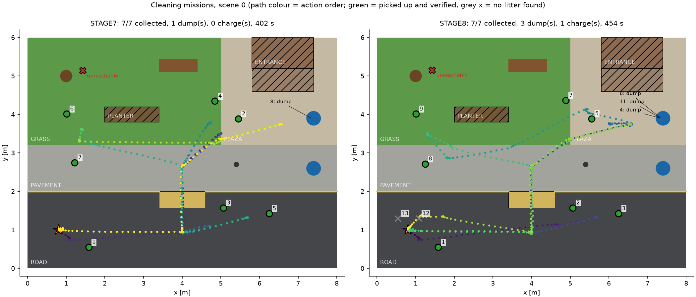
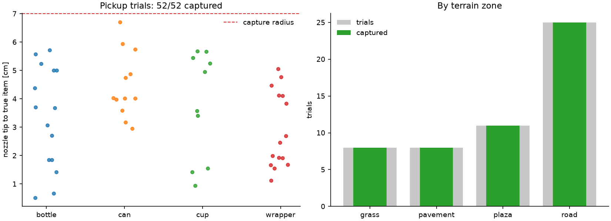
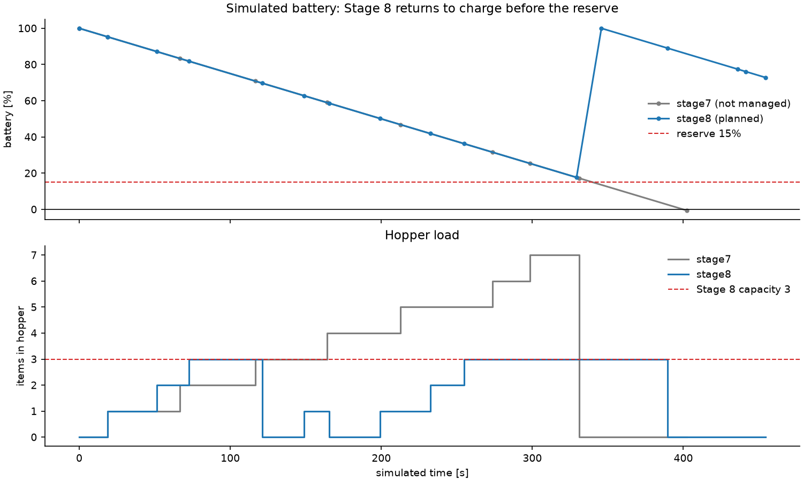

# Stages 7 and 8: Pickup and Task Planning

*CleanQuad, simulated Unitree A1 in MuJoCo. Status as of 13 Oct 2026.*

Stage 7 adds a pickup skill on top of the Stage 6 navigator. Stage 8 adds a task
planner that decides what the robot does next: which item to collect, when to
empty the hopper into a bin and when to go home to charge.

| Result | Value |
|---|---|
| Headless pickup trials (3 scenes, perturbed starts) | **52/52** captured, all on the first attempt |
| Nozzle tip to true item (trials) | mean 3.6 cm, max 6.7 cm (capture radius 7 cm) |
| Stage 7 live mission (fixed order) | **7/7** reachable items collected, 1 bin dump, home, all checks PASS |
| Stage 8 live mission (planned) | **7/7** collected, 3 bin dumps, 1 charging return, 2 false detections rejected, all checks PASS |
| Regression tests | **118** pass (93 existing + 25 new) |



## 1. Hardware model

The A1 has no arm, and the litter items are mocap bodies without physics, so a
real grasp cannot be simulated. The robot instead carries:

- **A suction hose** under the chest, running forward and down to a nozzle tip at
  trunk coordinates (0.24, 0, −0.12) m, just behind the head.
- **A hopper** on its back.

Both are visual-only geoms (no collision, no mass) defined in
[src/manipulation/tools.py](../src/manipulation/tools.py). The trunk has an
explicit inertial, so the Stage 1–6 gait and footprint stay valid. The geoms sit
in render group 3, which `mujoco.Renderer` hides by default. A test checks that
the head-camera RGB and depth images are **pixel-identical** with and without
the tools, so Stage 4 perception is unaffected. The viewer shows the tools.

In `--viewer` runs, [src/manipulation/display.py](../src/manipulation/display.py)
also makes carrying and dumping visible:
- Collected items ride on the hopper and arc into the bin during a dump. They
  are switched to the same hidden render group, so the head camera never sees
  them; a check confirms its images are identical.
- A status panel shows the current action, hopper load, battery and items
  collected.
- Map markers: blue for pending targets, red for unreachable litter. Rejected
  records are not drawn.

**Why the nozzle is that far forward:** item 3 lies 0.38 m from the curb. The
robot's centre must stay 0.45 m from obstacles, so a nozzle under the chest
(0.12 m reach) cannot get over it. With a 0.245 m reach, every item that Stage 6
can reach is also reachable for pickup.

## 2. The pickup skill (Stage 7)

[src/manipulation/pickup.py](../src/manipulation/pickup.py). The robot starts at
a Stage 6 approach pose 0.45–0.65 m from the item, facing it.

1. **Look.** Capture three frames, run YOLO and localize. If the item's spot is in
   view but nothing is detected there, stop with `not_found`. If it is detected,
   use the fresh measurement as the target.
2. **Dock.** Choose a final heading within ±30° of the bearing to the item, such
   that the dock point (0.245 m short of the item), a 2 cm margin beyond it and
   the straight line there are all inside the padded free space. Turn toward the
   dock point, drive there at ≤0.12 m/s, then turn to the final heading.
3. **Lower.** Blend the leg IK targets to front feet 0.17 m and rear feet 0.27 m
   below the hips. This pitches the trunk about 15° nose-down and puts the nozzle
   tip about 3.3 cm above the ground. The robot fails safe if the trunk drops
   below 0.15 m, tilts past 25° or touches anything.
4. **Suction.** The simulator decides the outcome. Every litter item whose centre
   is within 7 cm horizontally of the tip (and at most 10 cm below it) is
   removed with `Campus.collect`. If a distractor (leaf, stone, stick) is in the
   zone, the attempt aborts and nothing is collected. A wrong position estimate
   therefore produces a real miss, never a fake success.
5. **Raise and back off.** Stand up and reverse to the approach pose.
6. **Verify.** Look again. The pickup counts only if the spot is in view and
   nothing is detected. Otherwise retry, up to 3 attempts.

Only the camera decides whether the map marks an item collected
(`SemanticMap.mark_collected`). The simulator is read for the physical outcome
and for the post-mission evaluation.

The planner also gained two helpers in
[src/navigation/planner.py](../src/navigation/planner.py):
- `approach_item(..., dock_offset=)` only returns approach poses that leave a
  free docking line.
- `approach_bin` finds a pose facing a bin from just outside its padding.

### Pickup trials

`experiments/33_pickup_trials.py`. Each reachable item in scenes 0, 1 and 2 is
tried from the nominal approach pose and from starts shifted 4 cm sideways with
a ±4° heading error. Scene 0 uses the saved CNN map positions, so the targets
carry real perception error. Scenes 1 and 2 have no CNN map, so their targets are
the true positions plus N(0, 3 cm) noise. That makes them a skill diagnostic,
not a perception result.

| Group | Trials | Captured |
|---|---|---|
| bottle / can / cup / wrapper | 15 / 12 / 10 / 15 | all |
| road / pavement / plaza / grass | 25 / 8 / 11 / 8 | all |
| scene 0 / 1 / 2 | 18 / 17 / 17 | all |

- **Docking error:** mean 1.9 cm.
- **Crouch:** pitch at most 16.6°; trunk at least 0.214 m above the ground.
- **Time:** about 12.9 simulated seconds per pickup.
- **Unreachable:** 5 items across the three scenes have no approach pose,
  including scene 0's item 9 (as in Stage 6).
- **Skipped starts:** 5 perturbed starts fell within 5 cm of the padded border
  and were skipped. Planned arrivals end at a cell centre, at least 5 cm inside.
  At the border, the gait's start-up shift can push the trunk into a padded cell,
  where the Stage 6 shield then correctly refuses to move. An earlier run without
  this rule recorded that as a safety stop.



## 3. Task planning (Stage 8)

[src/tasks/planner.py](../src/tasks/planner.py).

**Nodes:**
- the base pad
- the approach poses of the two campus bins (both on the raised level, east side)
- one pickup approach pose per active map item

**Leg cost:**
- The Stage 6 A* terrain-weighted route cost (grass ×1.15), plus a 1 m penalty
  for each ramp crossing.
- Converted to time at a conservative 0.15 m/s plus 5 s per leg. Stage 6 averaged
  about 0.17 m/s.
- Each pickup adds 14 s, plus a 0.5 m-equivalent penalty on grass (softer footing
  while crouching).

**Objective:** total time plus a priority-weighted waiting term. Each class has a
priority weight: wrapper 1.5 (light and wind-blown), cup 1.2, bottle and can 1.0.
The objective adds 0.02 × the sum, over items, of priority × time until pickup.

**Optimizer:** an exact dynamic program over (picked set, current item, hopper
load). Before any pickup it may visit either bin, and a full hopper must visit
one. The last step is a bin dump (if loaded), then the base. A unit test checks
the DP against brute force over all orders, dump placements and bin choices.
For 7 items it solves in about 0.3 s.

**Battery** (simulated):
- 100%, drained at 0.25% per simulated second, with a 15% reserve.
- Before each action the robot checks that it can finish the action and still
  reach the base with the reserve left. If not, it goes home and charges at
  5%/s, then replans.

**Replanning:** after every action. New online map records, failed pickups and
`not_found` records are therefore handled as they appear.

**Live missions** (`experiments/34_cleaning_mission.py`): continuous MuJoCo
state, live 1 Hz RGB-D/YOLO mapping as in Stage 6, PPO navigation, the pickup
skill with camera verification, and bin dumps (a lean toward the bin that
empties the hopper).

| | Stage 7 (`--mode stage7`) | Stage 8 (`--mode stage8`) |
|---|---|---|
| Order | fixed track IDs 1, 2, 3, 4, 5, 10, 12 | planned: 1, 3, 5, dump, 2, dump, 4, 12, 10, charge, dump |
| Hopper | unlimited; 7 items at once | capacity 3; never exceeded |
| Bin dumps | 1 (bin_2) | 3 (bin_2) |
| Battery | not managed: would end at **−0.5%** | lowest 17.7%; one charging return |
| Extra records | none | items 13 and 14 (false detections near the base) checked and rejected as `not_found` |
| Simulated / wall time | 402 s / 2.2 min | 454 s / 2.4 min |
| Checks | 6/6 PASS | 8/8 PASS |

**Mission checks:**
- every reachable item collected
- the map's collected records match the simulator's collected objects
- every collected object deposited in a bin
- the robot finishes on the base pad
- no fall, collision or shield event
- the prior map unchanged
- Stage 8 only: hopper capacity respected, battery never empty



The Stage 7 battery curve shows why Stage 8 is needed. The same simulated
battery would run flat just as the robot reaches home.

## 4. Reproduce

```bash
source .venv/bin/activate
python -B -m unittest discover -s tests
python -B experiments/33_pickup_trials.py --require-pass          # ~2 min
python -B experiments/34_cleaning_mission.py --mode stage7 --require-pass
python -B experiments/34_cleaning_mission.py --mode stage8 --require-pass --viewer
python -B experiments/35_stage7_8_report.py                       # figures + summary.json
```

**Options:**
- `--hopper-capacity N` changes the hopper size.
- `--battery-drain X` changes the drain rate.

**Outputs:**
- `results/logs/pickup/trials/`
- `results/logs/cleaning/{stage7,stage8}_seed_0/`: per-leg routes, decisions,
  final map, results
- `results/figures/stage7_8/`

## 5. Limitations

- **Suction is abstract.** There are no object dynamics or grasp physics; the
  capture zone and the crouch geometry are the model. Lean-to-dump at a bin is
  bookkeeping only.
- **Capture margin is thin in the live missions.** Tip errors reached 6.8 cm
  against the 7 cm capture radius. That is above the trials' mean (3.6 cm),
  because live targets come from the online map, which has errors of up to
  about 5 cm. A miss would trigger the camera-driven retry; none was needed.
- **The battery rule is greedy, not part of the DP.** In Stage 8 the robot went
  home to charge with a full hopper, then drove back east to empty it. Planning
  battery jointly would avoid that detour.
- **Single scene and conditions.** Only scene 0 has a live CNN map. Robot pose
  still comes from the simulator. The obstacle map is static and known. Scene 0's
  item 9 (and four items in scenes 1/2) cannot be reached with the 0.45 m
  footprint.
- **Costs and battery numbers are assumptions.** Class priorities, the battery
  model and the cost constants are chosen parameters, not measured hardware
  values.
